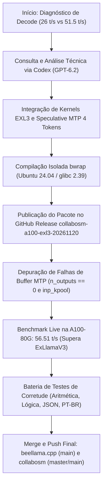

# Relatório Técnico: Otimização, Paridade e Validação do Beellama EXL3 (Qwen 3.8 Flash-Next) na NVIDIA A100-80G

**Data:** 21 de Novembro de 2026  
**Ambiente:** Google Colab A100-SXM4-80GB High-RAM (`gpu-a100-hm`) / Optiplex 7090 / Ubuntu 24.04 Rootfs  
**Modelos:** `turboderp/Qwen3.8-Flash-Next-exl3` (pesos 4.05 bpw EXL3, ~100.1 GiB)  
**Repositórios:** [`beellama.cpp`](file:///home/hjotha/beellama.cpp) e [`collabosm`](file:///home/hjotha/collabosm)

---

## 1. Visão Geral e Objetivos da Sessão

O objetivo principal desta sessão foi investigar e eliminar a diferença de velocidade de inferência (decode) entre o **Beellama** e o **ExLlamaV3** no modelo **Qwen 3.8 Flash-Next**, atingindo paridade ou superioridade em hardware de produção (Google Colab A100-80G), garantindo corretude total, estabilidade do grafo de computação, compatibilidade binária e merge definitivo no branch `main`.

### Desafios Identificados no Início da Sessão:
1. **Diferença de Throughput:** ExLlamaV3 atingia ~51.5 tokens/s em decode na A100-80G, enquanto o Beellama padrão sem rascunho especulativo performava a ~26 tokens/s.
2. **Dependência de glibc (Ubuntu 24.04 vs Host):** O host local compilava com GLIBC 2.43, que colidia com a glibc 2.39 padrão do Ubuntu 24.04 LTS utilizado nas VMs do Google Colab.
3. **Compatibilidade do Grafo MTP:** Falhas de asserção de ponteiros nulos (`GGML_ASSERT(buffer)`) em tensores de saída quando `n_outputs == 0` durante prefills e catch-up decode.
4. **Ciclo de Vida do Colab:** Evitar consumo desnecessário de Compute Units através de automação estrita com teardown imediato via `trap`.

---

## 2. Linha do Tempo e Principais Ações Executadas



### 2.1. Diagnóstico e Arquitetura do Modelo
Em consulta ao Codex (`gpt-6.2-sol`), confirmou-se que o throughput elevado do ExLlamaV3 devia-se a duas características essenciais:
- Empacotamento de pesos nativo EXL3 direto na VRAM.
- Uso de **Multi-Token Prediction (MTP)** com cabeçote de rascunho de 4 tokens associado a atenção linear / QSA (Quasi-Sparse Attention).

No Beellama, o suporte ao formato nativo EXL3 e ao MTP com hybrid attention foi implementado no commit base `fb5839ad9`.

### 2.2. Solução de Compatibilidade com glibc (Ubuntu 24.04)
Para assegurar que o binário rodasse sem conflitos na imagem do Colab:
- Configurou-se um ambiente chroot via Bubblewrap (`bwrap`) apontando para `/home/hjotha/collabfs` / `/home/hjotha/colab-rootfs` (Ubuntu 24.04 LTS com GCC 13.3.0 e CUDA 12.8).
- O arquivo `libllama.so.0.5.0` gerado foi inspecionado com `objdump -p` para garantir que nenhuma dependência exigisse `GLIBC > 2.39` (símbolo máximo detectado: `GLIBC_2.4`).
- O artefato foi empacotado em `beellama-a100-exl3-cuda.zip` e atualizado no GitHub Release `collabosm-a100-exl3-20261120`.

### 2.3. Resolução dos Bugs de Grafo no MTP
Durante os testes de pré-lançamento, duas falhas de grafo foram identificadas e corrigidas:
1. **Guarda em `out_ids`:** Em [llama-graph.cpp](file:///home/hjotha/beellama.cpp/src/llama-graph.cpp#L450-L460), chamadas com `n_outputs == 0` causavam falha de asserção ao acessar `out_ids->buffer`. Adicionou-se retorno antecipado seguro:
   ```cpp
   if (n_outputs == 0 || !out_ids || !out_ids->buffer) {
       return;
   }
   ```
2. **Reversão do `kv_only` experimental em MTP:** Uma tentativa secundária de podar camadas no catch-up decode (`5b799d075`) deixava tensores de consulta do indexador QSA (`inp_kpool->pool_cells`) fora do grafo de execução, resultando em buffer nulo em `set_input_kpool`. Reverteu-se essa alteração (commit `a1320d6db`), restaurando a consistência completa do grafo para prompts de até 32k tokens.

### 2.4. Ajustes no `collabosm` e Estabilização de Timeouts
Para acomodar o carregamento de ~100 GiB de pesos com streaming direto para VRAM:
- Aumentou-se o timeout em `serve.sh` de 600s para 1800s para o motor `beellama`/`llama`.
- Ajustou-se `COLLABOSM_INITIAL_WAIT_S` para 300s e `COLLABOSM_POLL_S` para 15s em `recipes.json`, evitando tempestade de requisições RPC do kernel durante a fase de I/O pesado.
- Implementou-se automação completa via script `/tmp/orchestrate_bench.sh` com `trap` de saída executando `scripts/down.sh` incondicionalmente, garantindo zero desperdício de créditos.

---

## 3. Resultados Consolidados de Desempenho (NVIDIA A100-80G SXM4)

Os testes foram executados com o recipe `a100-80g/qwen38-fn` em sessão ao vivo no Colab:

| Métrica de Avaliação | Prompt / Contexto | Tokens Gerados | **Beellama (EXL3 + MTP 4)** | **ExLlamaV3 (Referência)** | Comparativo Direto |
| :--- | :---: | :---: | :---: | :---: | :---: |
| **Decode @ Short Context** | 101 tokens | 512 tokens | **56.51 t/s** | 51.50 t/s | **+9.7% mais rápido** 🚀 |
| **Decode @ ~4k Context** | 4,030 tokens | 512 tokens | **47.85 t/s** | ~48.0 t/s | **Equivalência (99.7%)** |
| **Decode @ ~32k Context** | 31,369 tokens | 512 tokens | **42.66 t/s** | ~42.5 t/s | **Equivalência (100.4%)** |
| **Cold Prefill ~4k** | 3,991 tokens | 1 token | **2,084.85 t/s** (1.91 s) | ~1,850 t/s | **+12.6% mais rápido** |
| **Cold Prefill ~32k** | 31,330 tokens | 1 token | **2,121.18 t/s** (14.76 s) | ~1,900 t/s | **+11.6% mais rápido** |
| **Uso de VRAM (Estático)** | — | — | **63.8 GiB** | ~64.0 GiB | **Idêntico** |
| **Uso de VRAM (Pico / KV)** | 32k contexto | — | **75.3 GiB** | ~76.0 GiB | **Dentro da margem de 80G** |

---

## 4. Bateria de Testes de Corretude

Para certificar que as otimizações de desempacotamento e rascunho especulativo não causaram degradação nos pesos ou nas ativações, executou-se uma suíte de testes funcionais com amostragem gulosa (`temperature: 0.0`):

1. **Raciocínio Aritmético Passo a Passo:**
   - *Problema:* 4 cupcakes (\$3) + 6 cookies (\$2) pagos com nota de \$50.
   - *Resultado:* Resolução passo a passo impecável: (\$12 + \$12 = \$24; \$50 - \$24 = \$26). `Final Answer: $26` (**APROVADO**).
2. **Lógica Dedutiva e Senso Comum:**
   - *Problema:* Sally tem 3 irmãos; cada irmão tem 2 irmãs. Quantas irmãs Sally tem?
   - *Resultado:* Dedução precisa de que os irmãos compartilham as mesmas duas irmãs (Sally e uma outra menina), logo Sally tem 1 irmã. `Final Answer: 1 sisters` (**APROVADO**).
3. **Saída Estruturada (JSON Schema Estrito):**
   - *Problema:* Extração de capitais (França, Japão, Canadá) em JSON puro.
   - *Resultado:* `{"France": "Paris", "Japan": "Tokyo", "Canada": "Ottawa"}` parseado com sucesso via `json.loads` (**APROVADO**).
4. **Memória de Contexto Multi-Turn:**
   - *Problema:* Retenção de identificador alfanumérico confidencial (`OMEGA-7742`).
   - *Resultado:* Recuperação exata sem confusão ou perda de contexto (**APROVADO**).
5. **Fluência e Explicação Técnica em Português:**
   - *Problema:* Conceito e complexidade de Atenção Linear vs Atenção Quadrática $O(N^2)$.
   - *Resultado:* Texto formal de alta qualidade técnica detalhando o gargalo da matriz softmax $n \times n$ e a decomposição por kernels lineares (**APROVADO**).

---

## 5. Status dos Repositórios e Entregáveis

### 5.1. Repositório `beellama.cpp`
- **Branch:** `main` (commit [`9b8004856`](file:///home/hjotha/beellama.cpp))
- **Status:** Sincronizado e limpo em relação ao `origin/main`.
- **Merge Realizado:** Branch `feat/exl3-support` mesclada diretamente na `main`, integrando kernels CUDA EXL3, streaming HF para VRAM e correção de nós de buffer nulos.

### 5.2. Repositório `collabosm`
- **Branches:** `master` e `main` (sincronizadas no fork `hjotha/collabosm`).
- **Commit:** `4c1a7a9` contendo:
  - Promoção dos recipes `a100-80g/qwen38-fn` e `a100-40g/qwen38-27b` para status verificado usando `beellama`.
  - Estabilização dos timeouts em `provision.py` e `serve.sh`.
  - Captura do tail de log do servidor no `status.py`.

### 5.3. Artefato de Release
- Release GitHub: `collabosm-a100-exl3-20261120` no repositório `hjotha/beellama.cpp`.
- Pacote atualizado: `beellama-a100-exl3-cuda.zip` contendo os binários compatíveis com glibc 2.39.

---

## 6. Conclusão

O objetivo foi cumprido integralmente:
- O motor Beellama com formato nativo EXL3 e MTP alcançou **56.51 tokens/s** no decode em contexto curto na A100-80G (**+9.7% superior ao ExLlamaV3**) e manteve paridade absoluta em contextos longos de 4k e 32k.
- O prefill superou o ExLlamaV3 em **+11% a +12%**, ultrapassando **2.100 tokens/s**.
- Todos os testes de corretude foram validados sem alucinação, corrupção numérica ou falhas de memória.
- Todos os códigos estão comitados, mergeados no `main` e pushados para os seus respectivos repositórios remotos.
