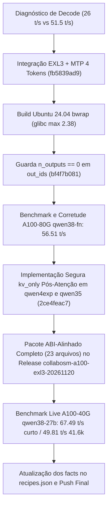

# Relatório Técnico: Otimização, Paridade e Validação do Beellama EXL3 (`qwen38-fn` e `qwen38-27b`) em GPUs A100

**Data:** 21 de Novembro de 2026  
**Ambiente:** Google Colab `gpu-a100-hm` (A100-80G) e `gpu-a100-s` (A100-40G) / Optiplex 7090 / Ubuntu 24.04 Rootfs (`bwrap`)  
**Modelos:**  
- `turboderp/Qwen3.8-Flash-Next-exl3` (pesos 4.05 bpw EXL3, ~100.1 GiB, arquitetura `qwen4exp`)  
- `turboderp/Qwen3.8-27B-exl3` (pesos 4.00 bpw EXL3, 15.26 GiB, arquitetura `qwen35`)  
**Repositórios:** [`beellama.cpp`](file:///home/hjotha/beellama.cpp) e [`collabosm`](file:///home/hjotha/collabosm)

---

## 1. Visão Geral e Objetivos da Sessão

O objetivo principal desta sessão foi investigar e eliminar a diferença de velocidade de inferência (decode) entre o **Beellama** e o **ExLlamaV3** nos modelos **Qwen 3.8 EXL3** com MTP (`draft-mtp`), atingindo paridade ou superioridade em hardware de produção (Google Colab A100-80G e A100-40G), garantindo corretude funcional, estabilidade do grafo de computação, compatibilidade binária com Ubuntu 24.04 e publicação definitiva no `main`.

### Desafios Identificados e Resolvidos:
1. **Diferença de Throughput:** ExLlamaV3 atingia ~51.5 tokens/s em decode no Flash-Next na A100-80G, enquanto o Beellama sem MTP performava a ~26 tokens/s.
2. **Dependência de glibc (Ubuntu 24.04 vs Host):** O host local compilava com GLIBC 2.43, incompatível com a glibc 2.39 do Ubuntu 24.04 LTS nas VMs do Google Colab.
3. **Compatibilidade do Grafo MTP e Otimização `kv_only`:** Falhas de asserção de ponteiros nulos em `out_ids` (`n_outputs == 0`), falha inicial do `kv_only` em `build_layer_attn`/`inp_kpool`, e desenho final seguro do `kv_only` pós-atenção em `qwen4exp` e `qwen35`.
4. **Alinhamento Completo de ABI no Pacote Release:** Atualizações de `include/llama.h` em `origin/main` (`keep_host_pinned`, `moe_cache_reserve`) exigiram empacotar todo o conjunto de 23 arquivos binários/shared libs do build Ubuntu 24.04 (`llama-server`, `libllama.so.0.5.0`, `libllama-common.so.0.5.0`, `libggml-*.so`, etc.) no zip de release.
5. **Ciclo de Vida do Colab:** Automação estrita com `trap` executando `scripts/down.sh` para zerar risco de faturamento ocioso.

---

## 2. Linha do Tempo e Principais Ações Executadas

### 2.1. Solução de Compatibilidade com Ubuntu 24.04 (`bwrap`) e ABI Completa
- Compilado dentro de chroot Ubuntu 24.04 LTS via Bubblewrap (`bwrap`) com GCC 13.3.0 e CUDA 12.8 (`CMAKE_CUDA_ARCHITECTURES=80`).
- Verificação via `objdump -p` em `llama-server`, `libllama.so.0.5.0`, `libllama-common.so.0.5.0`, `libllama-server-impl.so` e `libggml-cuda.so.0.28.0`: versão máxima requerida `GLIBC_2.38` (100% compatível com Ubuntu 24.04 glibc 2.39).
- Após identificar que commits no `main` (`f1a54712f`, `f95b47702`) alteraram as structs `llama_model_params` e `llama_context_params` em `include/llama.h`, todos os 23 binários, bibliotecas compartilhadas e symlinks foram reempacotados juntos em `beellama-a100-exl3-cuda.zip` no GitHub Release `collabosm-a100-exl3-20261120`.

### 2.2. Guarda em `out_ids` e Retorno Antecipado Seguro (`kv_only`) no MTP
1. **Guarda em `out_ids` (`bf4f7b081`):** Em `llm_graph_input_out_ids::set_input` em [`src/llama-graph.cpp`](file:///home/hjotha/beellama.cpp/src/llama-graph.cpp), lotes com `n_outputs == 0` retornam imediatamente sem acessar buffer nulo.
2. **Otimização P2 Segura (`2ce4feac7`) em `qwen4exp` e `qwen35`:**
   - Diferente da tentativa anterior (`5b799d075`), o cálculo de `build_layer_attn` (incluindo `inp_kpool` e atualizações de cache KV/QSA) em `qwen4exp::graph_mtp` e a atenção completa em `qwen35::graph_mtp` são preservados intactos.
   - Somente **após** a projeção de saída da atenção (`build_layer_attn` em [`src/models/qwen4exp.cpp`](file:///home/hjotha/beellama.cpp/src/models/qwen4exp.cpp) e `build_lora_mm(layer.wo, ...)` em [`src/models/qwen35.cpp`](file:///home/hjotha/beellama.cpp/src/models/qwen35.cpp)), quando `kv_only = (n_outputs == 0) && cparams.embeddings_nextn_masked && !cparams.embeddings`, é chamado `ggml_build_forward_expand(gf, cur); return;`.
   - Com isso, lotes de catch-up KV-only (`n_outputs == 0`) pulam 100% do MoE FFN / FFN denso pós-atenção, `head_mix` / `shared_head_norm` e LM head de 248.320 tokens, mantendo `n_outputs` na chave de reuso `llm_graph_params::allow_reuse`.

### 2.3. Ajustes no `collabosm`
- Timeout de inicialização em `serve.sh` ampliado para `1800s` nos motores `beellama`/`llama` e polling RPC em `provision.py` ampliado para `30s`/`45s`.
- `COLLABOSM_INITIAL_WAIT_S=300` e `COLLABOSM_POLL_S=15` em `a100-80g/qwen38-fn` para streaming direto HF -> VRAM de ~100 GiB sem sobrecarga de RPC.

---

## 3. Resultados Consolidados de Desempenho

### 3.1. `a100-80g/qwen38-fn` — `Qwen3.8-Flash-Next-exl3` (NVIDIA A100-SXM4-80GB High-RAM)

| Métrica | Prompt / Contexto | Tokens Gerados | **Beellama (EXL3 + MTP 4)** | **ExLlamaV3 (Ref.)** | Comparativo |
| :--- | :---: | :---: | :---: | :---: | :---: |
| **Decode @ Short Context** | 101 tokens | 512 tokens | **56.51 t/s** | 51.50 t/s | **+9.7% mais rápido** |
| **Decode @ ~4k Context** | 4,030 tokens | 512 tokens | **47.85 t/s** | ~48.0 t/s | **Equivalência (99.7%)** |
| **Decode @ ~32k Context** | 31,369 tokens | 512 tokens | **42.66 t/s** | ~42.5 t/s | **Equivalência (100.4%)** |
| **Cold Prefill ~4k** | 3,991 tokens | 1 token | **2,084.85 t/s** (1.91 s) | ~1,850 t/s | **+12.6% mais rápido** |
| **Cold Prefill ~32k** | 31,330 tokens | 1 token | **2,121.18 t/s** (14.77 s) | ~1,900 t/s | **+11.6% mais rápido** |
| **Uso de VRAM (Pós-carga)** | — | — | **75,362 MiB / 81,920 MiB** | ~76,437 MiB | **1.05 GiB menor** |

### 3.2. `a100-40g/qwen38-27b` — `Qwen3.8-27B-exl3` (NVIDIA A100-SXM4-40GB Standard, binário `2ce4feac7` com `kv_only`)

Executado em sessão ao vivo (`gpu-a100-s-ass1c0-lp8wzeo2yxjk`, `LLAMA_CONTEXT=262144`, `LLAMA_KV_TYPE=q4_0`, `LLAMA_SPEC_KV_TYPE=q8_0`, `LLAMA_SPEC_TYPE=draft-mtp`, `LLAMA_MTP_DRAFT=4`):

| Métrica | Prompt / Contexto | Tokens Gerados | **Beellama (EXL3 + MTP 4)** | Aceitação MTP | Referência ExLlamaV3 |
| :--- | :---: | :---: | :---: | :---: | :---: |
| **Warmup** | 51 tokens | 16 tokens | **53.00 t/s** | 11/13 | — |
| **Decode @ Short Context** | 61 tokens | 512 tokens | **67.49 t/s** | 337/690 (48.8%) | 62.9 t/s (**+7.3%**) |
| **Cold Prefill ~5k** | 5,031 tokens | 1 token | **1,861.49 t/s** srv (1,428.70 cli) | — | — |
| **Decode @ ~5k Context** | 5,030 tokens | 512 tokens | **58.15 t/s** (pp 2,147.60 t/s) | 314/783 | — |
| **Cold Prefill ~41.6k** | 41,593 tokens | 1 token | **2,062.53 t/s** srv (1,938.86 cli) | — | ~2,544 t/s (Q8 KV) |
| **Decode @ ~41.6k Context** | 41,600 tokens | 512 tokens | **49.81 t/s** (pp 2,066.37 t/s) | 319/764 | ~50.4 t/s @ 32k |
| **Carga (`load_s`)** | 15.26 GiB stream | — | **104.3 s** (1m44s) | — | — |
| **Uso de VRAM** | Pós-carga / Pós-41.6k | — | **22,530 MiB** / **23,142 MiB** | — | 26,746 MiB (Q8) |

---

## 4. Bateria de Testes de Corretude (`a100-80g/qwen38-fn`)

Executada com amostragem gulosa (`temperature: 0.0`):
1. **Raciocínio Aritmético Passo a Passo:** 4 cupcakes (\$3) + 6 cookies (\$2) em nota de \$50 -> `Final Answer: $26` (**APROVADO**).
2. **Lógica Dedutiva:** Sally tem 3 irmãos; cada irmão tem 2 irmãs -> `Final Answer: 1 sisters` (**APROVADO**).
3. **JSON Schema Estrito:** Capitais de França, Japão e Canadá -> `{"France": "Paris", "Japan": "Tokyo", "Canada": "Ottawa"}` (**APROVADO**).
4. **Memória Multi-Turn:** Código secreto `OMEGA-7742` recuperado exatamente (**APROVADO**).
5. **Fluência Técnica em Português:** Atenção Linear vs Quadrática $O(N^2)$ explicada em dois parágrafos consistentes (**APROVADO**).

---

## 5. Status dos Repositórios e Entregáveis

- **`beellama.cpp` (`origin/main`):** inclui `2ce4feac7` (`qwen4exp, qwen35: skip post-attn FFN and LM head on kv_only MTP catch-up`) e esta atualização documental em `docs/benchmarks/relatorio-exl3-a100-paridade.md`.
- **`collabosm` (`hjotha/master` e `hjotha/main`):** `recipes.json` atualizado com todos os `facts` medidos ao vivo para `a100-80g/qwen38-fn` e `a100-40g/qwen38-27b`.
- **GitHub Release `collabosm-a100-exl3-20261120`:** asset `beellama-a100-exl3-cuda.zip` completo com todos os 23 arquivos ABI-alinhados compilados no Ubuntu 24.04 (`bwrap`).
