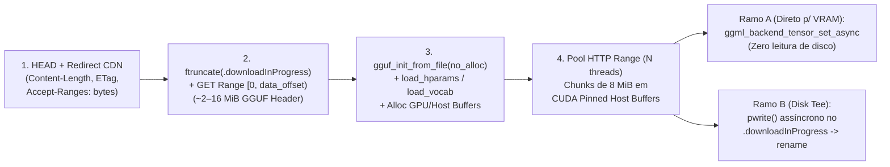

# Plano de Implementação: Streaming Multi-Thread Hugging Face → VRAM + Disk Tee (`beellama.cpp`)

- **Repositório alvo:** `/home/hjotha/beellama.cpp` na máquina `.57` (`192.168.1.57`, base `19f92e9df`)
- **Política Git (`AGENTS.md`):** Exceção `beellama.cpp` — editar diretamente no checkout principal `/home/hjotha/beellama.cpp` criando uma branch a partir do `main` (ex.: `git checkout -b feat/hf-stream-direct-vram main`).

---

## 1. Diagnóstico do Gargalo Atual no Código

Hoje, o carregamento de um modelo remoto (`-hf` / `--hf-repo` / `--hf-file` / `-mu`) executa **duas fases estritamente seriais**:

1. **Fase 1 — Download single-thread para o disco (`common/arg.cpp` → `common/download.cpp`):**
   - `common_models_handler_apply` (`common/arg.cpp:675-935`) monta a lista de `common_download_task` e chama `common_download_run_tasks` (`common/download.cpp:868-886`) **durante o parse de argumentos**, antes mesmo de `llama_model_load_from_file`.
   - `common_download_file_single_online` (`common/download.cpp:264-463`) faz um `HEAD` (`linha 346`), verifica `Accept-Ranges` (`linhas 369-372`) e chama `common_pull_file` (`linhas 175-260`), que abre **uma única conexão HTTP GET** e grava sequencialmente via `std::ofstream` em `<path>.downloadInProgress`.
2. **Fase 2 — Leitura do disco + Upload H2D para a VRAM (`src/llama.cpp` → `src/llama-model.cpp` → `src/llama-model-loader.cpp`):**
   - Só após o `std::rename` final do arquivo de `12+ GB`, `llama_model_load` (`src/llama.cpp:391-453`) instancia `llama_model_loader` (`src/llama-model-loader.cpp:546-689`), que chama `gguf_init_from_file(fname.c_str(), {.no_alloc = true, .ctx = &ctx})` (`linha 584`) para ler apenas os metadados e o diretório de tensores (`[0, data_offset)`).
   - Em seguida, `llama_model::load_tensors` (`src/llama-model.cpp:2020-2225`) aloca os buffers finais na GPU (`ggml_backend_alloc_ctx_tensors_from_buft`, `linha 2104`) e chama `ml.load_all_data` (`src/llama-model-loader.cpp:1594-1903`).
   - `load_all_data` lê **todos os 12+ GB novamente do disco** (`file->read_raw_unsafe`, `linha 1815`) para 4 buffers pinned de `1 MiB` (`linhas 1612, 1620`) e dispara `ggml_backend_tensor_set_async` (`linha 1833`).
   - Em VMs com RAM próxima ao tamanho do modelo (ex.: Colab T4 com `12,9 GiB` de RAM e GGUF de `12,1 GB`), o final da escrita na Fase 1 expulsa o início do arquivo do pagecache do Linux, forçando leitura fria de disco na Fase 2 (~95–106 s extras).

$$\text{Tempo Atual} = T_{\text{download 1-thread}}(12{,}1\text{ GB}) + T_{\text{disk read + H2D}}(12{,}1\text{ GB})$$

$$\text{Tempo Novo Modo} = T_{\text{header}}(2\text{–}16\text{ MiB}) + \max\!\left(T_{\text{download N-threads}}(12{,}1\text{ GB}),\; T_{\text{PCIe H2D}}\right)$$

Como o barramento PCIe H2D (~6–12 GB/s) é **50× a 100× mais rápido** que a rede (~60–250 MB/s), o upload para a VRAM fica 100% oculto atrás do download multithread, reduzindo o tempo pós-download para **próximo de zero**.

---

## 2. Arquitetura do Modo `--hf-stream-vram`



### Invariante-chave que simplifica toda a integração no `beellama.cpp`

Em `src/llama-model-loader.cpp:584` e `src/llama-model-loader.h:38-48`:
- `gguf_init_from_file(fname, {.no_alloc = true, .ctx = &ctx})` lê **exclusivamente** os primeiros `gguf_get_data_offset(metadata)` bytes do arquivo (`[0, data_offset)`).
- O construtor `llama_tensor_weight` (`src/llama-model-loader.h:45`) valida apenas `offs + ggml_nbytes(tensor) <= file->size()`.
- Portanto, se criarmos `<path>.downloadInProgress`, executarmos `ftruncate(fd, total_size)` e gravarmos apenas `[0, data_offset)` antes de abrir o `llama_model_loader`:
  1. **`--fit on` (`llama_params_fit`) funciona sem alteração**, pois o passo de dry-run (`no_alloc = true`) lê apenas `[0, data_offset)` e vê `file->size() == total_size`.
  2. **`load_hparams`, `load_vocab`, `create_tensor` e a alocação de `ggml_backend_buffer_t` na GPU (`src/llama-model.cpp:2020-2176`) funcionam sem alteração.**
  3. Apenas o preenchimento dos bytes dos tensores (`src/llama-model.cpp:2187-2222` / `ml.load_all_data`) é substituído pelo **motor de streaming multithread HTTP → Pinned RAM → VRAM + Disk Tee**.

---

## 3. Especificação de Flags CLI / INI / Env

Adicionar em `common/common.h` (`struct common_params`) e registrar em `common/arg.cpp` (próximo a `--hf-repo` na linha `4850` e `--load-mode` na linha `4471`):

| Flag CLI / Chave INI | Env Var | Default | Descrição |
|---|---|---|---|
| `--hf-download-threads N` / `hf-download-threads` | `LLAMA_ARG_HF_THREADS` | `8` | Número de conexões HTTP `Range` paralelas por arquivo GGUF (vale tanto para download normal em disco quanto para `--hf-stream-vram`). |
| `--hf-stream-vram` / `hf-stream-vram = true` | `LLAMA_ARG_HF_STREAM_VRAM` | `false` | Ativa o modo de streaming direto da rede para a VRAM (com Disk Tee simultâneo) quando o modelo ainda não está em cache local. |
| `--hf-stream-chunk-mb N` / `hf-stream-chunk-mb` | `LLAMA_ARG_HF_STREAM_CHUNK_MB` | `8` | Tamanho (em MiB) de cada bloco HTTP `Range` e buffer pinned de staging (`4` a `32` MiB). |
| `--hf-stream-disk-mode MODE` / `hf-stream-disk-mode` | `LLAMA_ARG_HF_STREAM_DISK_MODE` | `sync` | `sync`: aguarda a fila de `pwrite` terminar e faz `rename` antes de concluir `load_tensors`; `background`: libera o modelo na VRAM imediatamente após o último H2D e conclui o flush/rename do disco em background; `none`: carrega apenas na VRAM sem salvar o payload em disco (útil para discos minúsculos). |

---

## 4. Plano Detalhado por Arquivo no `/home/hjotha/beellama.cpp`

### Passo 1 — Resolver URL final do CDN e Suporte a Multi-Range (`common/download.h` e `common/download.cpp`)

1. **Problema de Redirect no `cpp-httplib`:**
   - O Hugging Face responde a `GET/HEAD /<repo>/resolve/<rev>/<file>.gguf` com `302`/`307` para um host assinado do CDN (`cas-bridge.xethub.hf.co` ou `cdn-lfs...`).
   - Em `common/download.cpp:325-372`, extrair um helper:
     ```cpp
     struct common_resolved_remote_file {
         std::string final_url;      // URL final após redirects (sem re-bater no hub a cada chunk)
         std::string etag;
         size_t      total_size = 0;
         bool        supports_ranges = false;
     };
     ```
   - Implementar `common_resolve_remote_file(const std::string & url, const common_download_opts & opts, common_resolved_remote_file & out)`:
     - Segue redirects (`301/302/303/307/308`) manualmente em `HEAD` (ou `GET Range: bytes=0-0` caso o CDN assinado rejeite `HEAD`), preservando `Authorization: Bearer` apenas no domínio `huggingface.co` (não enviar o token HF para o S3/CDN externo, evitando erro `400 InvalidArgument` da AWS/GCS).
     - Extrai `total_size` de `Content-Range: bytes 0-0/<total>` ou `Content-Length`, `etag` e `supports_ranges = true`.

2. **Download Multi-Thread em Disco (`common_pull_file_parallel` em `common/download.cpp`):**
   - Mesmo quando `--hf-stream-vram` estiver desligado (ex.: sidecars `mmproj`, ou download prévio), se `supports_ranges && p.total >= 16 * 1024 * 1024 && opts.n_threads > 1`:
     - Abre `<path>.downloadInProgress` com `open(..., O_CREAT | O_RDWR, 0644)` e `ftruncate(fd, p.total)`.
     - Divide `[0, p.total)` em `chunks` de `8 MiB` consumidos por `opts.n_threads` workers via `std::atomic<size_t> next_chunk{0}`.
     - Cada worker mantém um `httplib::Client` persistente (`set_keep_alive(true)`) conectado ao host de `final_url`, requisita `Range: bytes=start-end` e escreve direto no `fd` com `pwrite(fd, data, len, offset)` (thread-safe no POSIX sem `mutex` de arquivo).

---

### Passo 2 — Bootstrap do Cabeçalho GGUF (`common_prepare_gguf_stream_header` em `common/download.cpp`)

Quando `params.hf_stream_vram` estiver ativo para um arquivo `.gguf` que **não** está em cache (`!cache_hit()`):

1. Em `common_models_handler_apply` (`common/arg.cpp:911-935`), em vez de baixar os `12+ GB` inteiros antes de iniciar o `llama_model_load`:
   - Chama `common_prepare_gguf_stream_header(task)`:
     1. Adquire o `common_file_lock` (`<path>.lock`) e resolve `final_url`, `total_size`, `etag`.
     2. Abre `<local_path>.downloadInProgress` (`fd`) e executa `ftruncate(fd, total_size)`.
     3. Baixa os primeiros `2 MiB` (`Range: bytes=0-2097151`) e grava em `fd` no offset `0`.
     4. Inspeciona o offset de dados GGUF (`gguf_init_from_file` com `no_alloc = true` ou leitura leve do cabeçalho):
        - Se `gguf_init_from_file` precisar de mais bytes (ex.: modelos com vocabulário grande onde `data_offset > 2 MiB`, chegando a ~8–16 MiB), baixa o intervalo complementar `[2 MiB, data_offset)` em janelas de `8 MiB` até `gguf_init_from_file` retornar um `gguf_context *` válido com `data_offset = gguf_get_data_offset(ctx)`.
     5. Registra um descritor `llama_stream_download_plan` associado ao caminho `<local_path>.downloadInProgress`:
        ```cpp
        struct llama_stream_download_plan {
            std::string final_url;
            std::string temp_path;
            std::string final_blob_path;
            std::string snapshot_path; // hf_cache::finalize_file target
            std::string etag;
            std::string lock_path;
            int         fd = -1;
            size_t      total_size = 0;
            size_t      data_offset = 0; // bytes [0, data_offset) já estão gravados em fd
            int         n_threads = 8;
            size_t      chunk_bytes = 8 * 1024 * 1024;
            int         disk_mode = 0;   // 0=sync, 1=background, 2=none
        };
        ```
     6. Define `params.model.path = temp_path` e força `params.load_mode = LLAMA_LOAD_MODE_NONE` (desabilitando `mmap`, pois os tensores serão carregados diretamente nos buffers da GPU/Host via streaming).

---

### Passo 3 — Motor de Streaming Direto para VRAM + Disk Tee (`src/llama-model-loader.h/.cpp` e `src/llama-model.cpp`)

1. **Mapa de Intervalos de Tensores (`src/llama-model-loader.h`):**
   - Em `llama_model::load_tensors` (`src/llama-model.cpp:2185-2200`), após todos os `ggml_backend_alloc_ctx_tensors_from_buft` terem alocado a memória real de todos os `ctx_bufs` (tanto o contexto principal quanto `mtp_groups`):
   - Construir um vetor ordenado por offset de arquivo `std::vector<tensor_Extent>`:
     ```cpp
     struct tensor_stream_target {
         size_t        file_offs;   // weight->offs (sempre >= data_offset)
         size_t        nbytes;      // ggml_nbytes(tensor)
         ggml_tensor * tensor;      // destino já alocado na GPU ou Host
         bool          is_host;     // ggml_backend_buffer_is_host(tensor->buffer)
         uint8_t *     mtp_backing; // ponteiro opcional em group.host (se split_mtp_weights)
     };
     ```
   - *Atenção a tensores duplicados (`TENSOR_DUPLICATED` em `src/llama-model-loader.cpp:1413`):*
     - Se dois `ggml_tensor *` em buffers distintos apontarem para o mesmo `weight->offs` (ex.: `token_embd.weight` na CPU e `output.weight` na GPU), ambos entram no vetor ordenado com o mesmo `file_offs`, e ambos recebem a cópia quando o chunk correspondente chega!
   - *Atenção a tensores ignorados (`TENSOR_SKIP` em `src/llama-model-loader.cpp:1205`, ex.: `blk.64.*` quando `load_mtp == false`):*
     - Esses ranges **não** possuem `tensor_stream_target` para a VRAM, mas seus bytes no intervalo `[data_offset, total_size)` ainda são baixados e gravados pelo **Disk Tee** (quando `disk_mode != none`) para garantir que o arquivo `.gguf` salvo em disco fique 100% íntegro e idêntico ao upstream.

2. **Execução Paralela `load_all_data_streaming` (`src/llama-model-loader.cpp`):**
   - Substitui o loop `for (auto & [ctx, bufs] : ctx_bufs) ml.load_all_data(...)` em `src/llama-model.cpp:2187` quando `ml.has_stream_plan()` for verdadeiro:
   - **Alocação de Buffers Pinned + Streams CUDA por Worker:**
     - Para cada um dos `N` workers (`n_threads`, default `8`):
       - Inicializa uma instância `ggml_backend_t upload_backend_i = ggml_backend_dev_init(gpu_dev, nullptr)` (cria uma CUDA stream dedicada por worker, ou compartilha um pool de `4` streams protegidas por mutex leve).
       - Aloca **2 buffers pinned de `chunk_bytes` (`8 MiB`)** via `ggml_backend_buft_alloc_buffer(host_buft, chunk_bytes)` + `ggml_backend_event_t` para double-buffering (`N × 2 × 8 MiB = 128 MiB` de RAM pinned total).
   - **Loop de Download + H2D + Disk Tee de cada Worker:**
     - Os intervalos `[data_offset, total_size)` são divididos em blocos de `chunk_bytes` (`8 MiB`).
     - O worker `i` pega o próximo bloco `[c_start, c_end)` via `atomic_fetch_add`:
       1. Sincroniza o evento CUDA do buffer ativo (`ggml_backend_event_synchronize(ev)`), garantindo que o DMA anterior daquele buffer já terminou.
       2. Executa `cli.Get(path, {{"Range", "bytes=" + c_start + "-" + (c_end - 1)}}, receiver_cb)` escrevendo diretamente no ponteiro pinned `pinned_ptr`.
       3. Faz busca binária (`std::lower_bound`) no vetor `tensor_stream_target` para encontrar todos os tensores que intersectam `[c_start, c_end)`:
          - Para cada interseção `[ slice_start, slice_end ) = [ max(c_start, t.file_offs), min(c_end, t.file_offs + t.nbytes) )`:
            - `in_chunk_off = slice_start - c_start`
            - `tensor_rel_off = slice_start - t.file_offs`
            - `slice_len = slice_end - slice_start`
            - Se `t.is_host`:
              `memcpy((uint8_t *)t.tensor->data + tensor_rel_off, pinned_ptr + in_chunk_off, slice_len);`
            - Se GPU:
              `ggml_backend_tensor_set_async(upload_backend_i, t.tensor, pinned_ptr + in_chunk_off, tensor_rel_off, slice_len);`
            - Se `t.mtp_backing != nullptr`:
              `memcpy(t.mtp_backing + tensor_rel_off, pinned_ptr + in_chunk_off, slice_len);`
       4. Registra o evento CUDA (`ggml_backend_event_record(ev, upload_backend_i)`).
       5. **Disk Tee:**
          - Em modo `sync`: chama `pwrite(fd, pinned_ptr, c_end - c_start, c_start)` (executa em paralelo ao DMA PCIe da GPU!).
          - Em modo `background`: copia ou transfere o bloco para uma fila bounded (`64` blocos = `512 MiB` máx.) consumida por 2 threads de escrita em disco em background.
   - **Finalização:**
     - Ao terminar todos os blocos:
       - Sincroniza todas as `upload_backend_i` (`ggml_backend_event_synchronize`) e libera os buffers pinned.
       - Se `check_tensors` estiver ativo, executa `ggml_validate_row_data`.
       - Finaliza o arquivo em disco: `close(fd)`, `std::rename(temp_path, final_blob_path)`, grava `.etag`, chama `hf_cache::finalize_file` e libera o `.lock`!

---

## 5. Tratamento de Casos de Borda e Resiliência

1. **Queda de conexão em um chunk (`Retry` por chunk):**
   - Cada bloco `[c_start, c_end)` é idempotente! Se `cli.Get` falhar ou retornar status `!= 206` em um worker, o worker reconecta e re-tenta apenas aquele bloco de `8 MiB` (até 4 tentativas com backoff exponencial `1s, 2s, 4s`), sem perder nada do que já foi enviado para a VRAM ou gravado em disco.
2. **Retomada de download parcial (`.downloadInProgress` pré-existente):**
   - Se um download anterior sem streaming deixou um `.downloadInProgress` parcial válido (mesmo `.etag`), ou se o servidor não suportar `Accept-Ranges: bytes`, o código faz fallback transparente para o caminho tradicional (`common_download_file_single` → `load_all_data`).
3. **Modelos Sharded / Split GGUF (`00001-of-00003.gguf`):**
   - Em `common_prepare_gguf_stream_header`, prepara o cabeçalho `[0, data_offset_i)` de cada split `idx = 0 .. n_split - 1`, e o `tensor_stream_target` inclui o campo `uint16_t file_idx` (`weight->idx`), permitindo que os workers façam streaming de múltiplos splits da mesma forma.
4. **Economia no `split_mtp_weights` (`src/llama-model.cpp:2201-2222`):**
   - Hoje, `src/llama-model.cpp:2220` faz `ggml_backend_tensor_get(t, group.host.data() + offset, 0, bytes)` (lendo `348 MB` de volta da VRAM para a RAM!). Preenchendo `group.host` diretamente durante o streaming (item 3.2 acima), evitamos inclusive essa leitura D2H no boot.

---

## 6. Plano de Testes e Validação na `.57` e na T4

1. **Teste Unitário Determinístico (`tests/test-hf-stream-vram.cpp`):**
   - Subir um servidor HTTP local em loopback (`httplib::Server` em `127.0.0.1:0`) servindo um GGUF sintético pequeno (~64 MiB, com suporte a `HEAD` e `Range: bytes=...` e injeção de falha transiente em 1 chunk).
   - Carregar o modelo duas vezes:
     - `model_ref`: via `llama_model_load_from_file` tradicional.
     - `model_stream`: via `--hf-stream-vram --hf-download-threads 4`.
   - Verificar:
     - Igualdade bit-a-bit (`memcmp`) de todos os tensores na GPU (`ggml_backend_tensor_get`) e na CPU entre `model_ref` e `model_stream`.
     - Igualdade de SHA256 do arquivo `.gguf` persistido pelo Disk Tee com o arquivo original.
2. **Benchmark Real na `.57` (RTX 4070) e no Colab T4:**
   - Remover o cache local do `Swift-1.5-Qwen3.8-27B-GSQ-RCO-IQ3_S-mtp.gguf` (`12,1 GB`) e medir o tempo total do comando `llama-server -hf ukisai/Swift-1.5-Qwen3.8-27B-GSQ-RCO-GGUF -hff Swift-1.5-Qwen3.8-27B-GSQ-RCO-IQ3_S-mtp.gguf --hf-stream-vram --hf-download-threads 8` até `/health == 200`:
     - Confirmar eliminação total dos ~95 s de `load_model` pós-download e integridade dos logits no primeiro prompt.
