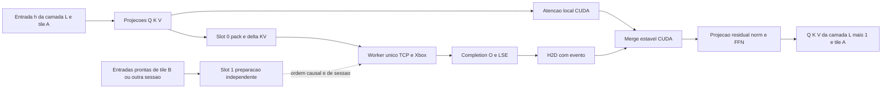
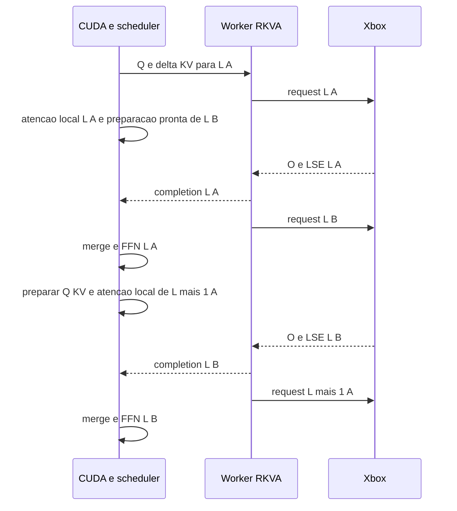

# Revisão e plano mestre de atenção distribuída BeeLlama.cpp e XLLAMA

Data da revisão: 20 de outubro de 2026. Plataforma de destino: Legion Go, eGPU NVIDIA e Xbox Series X em UWP, com RKVA v2 sobre Ethernet Gigabit.

A prioridade é corrigir e instrumentar o caminho existente, otimizar a atenção remota e só então introduzir pipeline por tiles de prefill. **Uma fila de dois slots não remove a dependência entre camadas do mesmo token.** No decode exato, `Q[L+1]` só existe depois do merge, da projeção de saída e do FFN de `L`, além das operações intermediárias do modelo. Não é possível eliminar essa espera simplesmente antecipando RPCs de camadas futuras.

O caminho FP8 tem mérito de desempenho nos resultados fornecidos, mas seu contrato numérico precisa de correção. O SplitZip examinado não comprime: seu tamanho mínimo excede F16 bruto, o framing mantém os tamanhos F16 e seu decoder possui uma leitura fora dos limites reproduzida com AddressSanitizer. Isso muda a recomendação de manutenção desse modo.

## Escopo e evidências

Foram examinados os checkouts locais, incluindo alterações não commitadas:

| Componente | Base Git | Estado relevante |
| --- | --- | --- |
| BeeLlama.cpp | `aaa63758a968577c593654d27b80de748dd15c6a` | Alterações locais em argumentos, codec, protocolo e testes |
| XLLAMA | `3c657399733a18559548cca0cf103dfe6a273cba` | Alterações locais em protocolo, codecs, bulk UWP e testes |

Os números de bancada deste documento são os fornecidos no pedido. Os experimentos executados nesta revisão são testes CPU de codecs e de validação de payload; não são novas medições de inferência ou GPU. O pacote instalado no Xbox não foi comparado aos fontes por hash. Assim, um defeito no checkout não implica que o mesmo defeito estivesse no binário que produziu cada medição histórica.

A geometria especializada encontrada no código é `Hq=24`, `Hkv=4`, `D=256`, GQA de seis query heads por KV head e 16 camadas remotas de atenção completa. Validar esses valores no GGUF realmente utilizado. O nome informal “Qwen 2.5 / 3.8-27B GSQ IQ3_XXS com MTP” não identifica univocamente arquitetura, pesos, draft e tokenizer. Modelos Qwen com camadas recorrentes também impõem dependências de estado entre tiles.

O hardware informado deve entrar no manifesto de benchmark, acompanhado da identificação real da GPU, VRAM reportada, driver, ligação USB4 e NIC. A designação “RTX 4070 Laptop 12 GB” precisa dessa identificação antes de dimensionar buffers; o planejamento abaixo não depende de inferir o SKU pelo nome.

### Achados ordenados por prioridade

| Prioridade | Achado verificável | Consequência e ação |
| --- | --- | --- |
| P0 | SplitZip calcula offsets sem validar o tamanho mínimo das seções | Leitura fora do buffer reproduzida com ASan. Corrigir antes de habilitar esse decoder em produção |
| P1 | SplitZip ocupa `12+n+2*ceil(n/2)+escapes` bytes | Nunca é menor que `2n`. Arquivar o modo atual e usar F16 como referência lossless |
| P1 | Conversão F16 para FP8 no Xbox pode gerar Inf a partir de F16 finito | Validar a faixa E5M2 e o resultado da conversão; definir erro ou saturação explicitamente |
| P1 | FP8 usa F32→F16 RNE seguido de soma `0x80` e truncamento | Empates afastam-se de zero; há duplo arredondamento. Definir e testar um único contrato CPU/GPU |
| P1 | “Zero fallback” depende de `GGML_RKVA_WIRE_STRICT=1` | A opção CLI sozinha permite fallback para F16. Tornar uma escolha explícita de wire estrita |
| P1 | Bulk F16/FP8 não tem a mesma instrumentação GPU do bulk F32 | `range_wait` não identifica sozinho o custo de MQ4; instrumentar antes de atribuir causalidade |
| P2 | O bulk GPU copia O/LSE F32 para um stage que não é consumido | Suprimir essa cópia no caminho qualificado e medir |
| P2 | Forward e inverse WHT são repetidas por split | Pré-computar Q rotacionado e estudar inverse WHT após o merge de splits |
| P2 | Worker destrói o `unique_ptr` do job sem devolvê-lo ao pool | A reutilização de jobs declarada não ocorre no caminho normal; corrigir ownership e alocações |
| P3 | Dois slots e múltiplas requisições exigem novos contratos de lifetime e ordenação | Introduzir depois dos ganhos locais, sem tornar concorrentes os recursos globais atuais do engine |

## Parte 1 Revisão das otimizações do Build 273

### 1.1 O que os resultados permitem concluir

| Wire no Build 273 | Prefill em 102,4k | Prefill em 112,6k | Decode em 102,4k | Decode em 112,6k |
| --- | ---: | ---: | ---: | ---: |
| F16 | 73,75 t/s | 44,09 t/s | 18,18 t/s | 17,03 t/s |
| FP8 | 82,34 t/s | 44,21 t/s | 18,27 t/s | 17,44 t/s |
| SplitZip | 68,37 t/s | Não especificado numericamente | 17,67 t/s | Não especificado numericamente |

Em 102,4k, a redução de bytes com FP8 é consistente com uma redução do caminho crítico de transporte. Em 112,6k, o platô torna improvável uma explicação exclusivamente baseada no volume de Q/O na rede. **Ele não prova que os 116 ms sejam tempo do shader.** A espera inclui o serviço remoto restante, cópias, fences, transcodificação, socket e eventual atraso de scheduling.

O dado de Build 270 para 112,6k, 51,03 t/s, é superior aos 44,25 t/s do Build 271, embora o decode melhore. Isso exige acompanhar separadamente prefill e decode; uma otimização de overlap pode regredir por preparação, particionamento ou mudanças na cadência.

Os tempos de parede também precisam de uma decomposição comum. SplitZip registra TPS de prefill inferior e tempo total menor que F16; isso é possível se outras fases dominarem o total, mas não permite atribuir a diferença à compressão. Registrar tokens efetivamente processados, fases, snapshots, warmup, MTP e condições térmicas em cada execução.

### 1.2 FP8 E5M2 no host

Os codecs estão em [ggml-remote-attn.cpp](../ggml/src/ggml-remote-attn/ggml-remote-attn.cpp#L149), funções `rkva_f32_to_fp8_batch` e `rkva_fp8_to_f32_batch`.

O caminho vetorizado converte oito floats por iteração:

```cpp
// Contrato observado, não a correção proposta.
h = _mm256_cvtps_ph(v, RNE);
b = pack_u8((h + 0x0080) >> 8);
```

E5M2 compartilha com binary16 o sinal, o expoente de cinco bits e o bias 15. Por isso, expandir um byte E5M2 para `uint16_t(byte)<<8` produz a representação F16 exata correspondente. O decoder vetorizado rejeita expoente 31 antes de `_mm256_cvtph_ps`, o que evita propagar Inf/NaN recebidos.

| Propriedade E5M2 | Valor |
| --- | ---: |
| Maior finito | 57.344 |
| Menor normal positivo | `2^-14 ≈ 6,1035e-5` |
| Menor subnormal positivo | `2^-16 ≈ 1,5259e-5` |
| Metade do menor subnormal | `2^-17 ≈ 7,6294e-6` |
| Precisão da significand normal | Três bits, incluindo o bit implícito |

**Não há clamping no encoder do host.** Valores não finitos ou `abs(x)>57344` causam `false`; a preparação do job falha. Isso é fail-closed, mas não é saturação. Uma política de saturação precisaria preservar o sinal, limitar a magnitude a `0x7b` e contar cada ocorrência. Uma política de erro deve validar Q e O simetricamente e informar camada, faixa e contagem, sem devolver um resultado parcial válido.

A soma incondicional de `0x80` implementa arredondamento de magnitude com empate para cima, não round-to-nearest-even. Exemplos reproduzidos:

| Entrada | Código atual | Resultado atual | RNE direto para E5M2 |
| --- | --- | ---: | ---: |
| `1.125` | `0x3d` | 1,25 | 1,0 |
| `-1.125` | `0xbd` | -1,25 | -1,0 |
| `1.12489998` | `0x3d` | 1,25 | 1,0 |
| `2^-17` | `0x01` | `2^-16` | +0 |
| `60000` | Rejeitado | Sem saída válida | 57.344 em RNE ordinário |

O terceiro exemplo é duplo arredondamento: o primeiro passo produz o midpoint F16, e o segundo escolhe o lado errado para o F32 original. Para uma entrada que já é F16, a correção RNE do descarte de oito bits usa `0x7f + ((h >> 8) & 1)` na magnitude, com tratamento separado de sinal, especiais e overflow. Isso **não resolve sozinho** o duplo arredondamento F32→F16→FP8. Para Q F32, implementar conversão direta ou uma correção dos casos de midpoint baseada nos bits F32 originais.

O caso 60.000 mostra também que rejeitar todo valor acima do maior representável é mais restritivo que arredondar para o vizinho E5M2: esse valor ainda arredonda para 57.344. Qualquer escolha é implementável, mas precisa constar do contrato e ser igual em Q e O.

Subnormais E5M2 são representáveis no formato e expandem exatamente para F16. Abaixo de aproximadamente metade do menor subnormal, o valor vira zero; no midpoint o codec atual escolhe o subnormal. Testar os valores imediatamente antes e depois desses limites, sinais e preservação de zero negativo. Não presumir uma política comum de flush-to-zero entre software, F16C e shader: verificar as conversões efetivamente compiladas.

E5M2 não dispõe de escalas por cabeça no protocolo atual. O erro relativo de arredondamento de valores normais é da ordem de até 12,5%; componentes pequenos podem desaparecer. Para o score:

\[
\delta s_i = \frac{\delta q^T k_i}{\sqrt D},\qquad
|\delta s_i|\leq\frac{\|\delta q\|_2\|k_i\|_2}{\sqrt D}.
\]

Outliers e scores próximos podem amplificar a mudança de probabilidades. Um throughput semelhante de decode não é evidência de equivalência numérica ou de preservação da aceitação MTP. Manter acumulação, normalizadores e LSE em F32; medir erro em Q/O, distribuição dos logits, KL e comportamento de verificação especulativa.

### 1.3 SIMD e contrato de execução

O hot loop usa principalmente operações de 128 bits sobre os oito halves produzidos pela conversão de 256 bits. O pack não mistura lanes incorretamente: o shift lógico resulta em inteiros 0..255, e `_mm_packus_epi16` os preserva. As operações de load/store são unaligned e o tail escalar existe.

O gate é de compilação, `__AVX2__ && __F16C__`, não dispatch de CPU em runtime. Confirmar as flags do objeto `ggml-base`, em que esse arquivo é compilado; `GGML_NATIVE=ON` por si só não demonstra que esse trecho recebeu as flags. Um binário portátil precisa de dispatch explícito para executar em CPUs sem essas instruções. Inspecionar assembly e contadores de alocação antes de atribuir todo o ganho ao SIMD.

Priorizar pools fixos e eliminação de conversões/copias sobre vetorização adicional. Em um host limitado a 10 W, um codec que reduz bytes e aumenta trabalho CPU pode perder TPS ou alterar os clocks da APU durante o benchmark.

### 1.4 FP8 no Xbox e D3D12

O caminho atual em [rkva-kvarn-bulk-f16.inc](../../xllama-qwen35-xbox/uwp/rkva/rkva-kvarn-bulk-f16.inc#L145) expande bytes FP8 escalarmente para F16 **dentro do upload mapeado**. Depois, um shader separado expande F16 para Q F32. Isso evita um buffer CPU Q F32 nesse caminho, mas mantém dois passos de conversão e um dispatch de unpack.

A saída percorre `O F32 GPU → pack F16 GPU → readback → vetor F16 CPU → pack FP8 CPU → socket`, em [remote-attn.cpp](../../xllama-qwen35-xbox/uwp/rkva/remote-attn.cpp#L694). Portanto, ainda não há pack FP8 direto na GPU para o readback.

O pack de O faz `(half+0x80)>>8` sem limitar a faixa E5M2. F16 finito a partir de `0x7b80` positivo, ou correspondente negativo, vira Inf E5M2. Enumerando os padrões F16 finitos, **256 padrões de bits** produzem especiais FP8 com essa fórmula. A validação F16 anterior permite esses valores. O decoder host rejeita a resposta, encerrando a operação, mas o servidor já terá modificado o cache.

Corrigir com uma especificação única de overflow, rounding e subnormais. Usar vetores de conformidade comuns ao host e ao Xbox. Se a política mudar, negociar uma revisão de codec: o mesmo bit de capacidade não deve esconder duas semânticas diferentes. Preservar a validação antes de mutação quando aplicável e invalidar a sessão em resultado numérico inválido após execução.

Em seguida, criar PSOs que leiam FP8 diretamente no unpack/WHT e escrevam FP8 no pack final, mantendo LSE F32. Validar bytes e contadores de saturação na GPU, com uma pequena área de status. Não copiar O inteiro para CPU apenas para verificar sua faixa.

### 1.5 Negociação estrita

O bit 10, `RKVA_CAP_KVARN_BULK_FP8`, existe nos dois headers. Entretanto, em `rkva_configure_native_kvarn`, a falta da capacidade só causa erro quando `GGML_RKVA_WIRE_STRICT=1`. Sem essa variável, há warning e fallback para F16. A opção `--remote-attn-wire-format fp8` apenas define `GGML_RKVA_WIRE_FORMAT`.

Logo, a promessa de zero fallback não corresponde ao caminho CLI isolado. Uma escolha explícita de wire deve falhar se indisponível; reservar negociação automática para um modo `auto` explicitamente solicitado. O HELLO/log deve registrar versão, geometria, descriptor, wire solicitado, wire efetivo e revisão de codec. Os testes atuais cobrem tanto erro estrito quanto fallback; atualizar o contrato e os testes juntos.

### 1.6 SplitZip

O encoder em [ggml-remote-attn.cpp](../ggml/src/ggml-remote-attn/ggml-remote-attn.cpp#L224) e seu equivalente no Xbox separam:

1. Oito bits baixos por elemento: `n` bytes.
2. Um nibble de expoente por elemento: `ceil(n/2)` bytes.
3. Sinal e dois bits altos de mantissa, também em um nibble: `ceil(n/2)` bytes.
4. Um byte extra por expoente fora da tabela, mais cabeçalho de 12 bytes.

Assim:

\[
B_{sz}=12+n+2\lceil n/2\rceil+E > 2n = B_{f16}.
\]

O bit não utilizado no nibble sinal/mantissa anula a economia de um bit do expoente. Não há etapa posterior de entropia. Os testes reproduziram 2.060 bytes para 1.024 valores iguais a 1,0, contra 2.048 bytes F16; para zeros, 3.084 bytes, pois expoente zero usa escape.

Além disso, o host reserva Q com tamanho fixo de `2n`, tenta comprimir e usa raw F16 se o resultado for maior. O servidor faz o mesmo para O; a resposta continua reservando `2n + bytes_lse`. **O modo examinado transmite raw F16 após pagar a tentativa de compressão.** Mesmo um encoder menor, sozinho, não reduziria os bytes no framing atual.

Isso explica a penalidade de TPS sem precisar supor que o bit-packing escalar fosse a única causa: há múltiplas passagens, alocações de vetores, escapes e cópias, sem economia de wire nesta implementação. Uma redução real de tráfego atribuída a SplitZip exige conferir o binário, o formato efetivo e os contadores daquela execução.

O decoder tenta identificar o formato pelo conteúdo: se `splitzip_decode()` falha, os chamadores reinterpretam os bytes como F16 bruto. Um header malformado não pode servir de sinalização de raw. Existem colisões possíveis entre dados F16 e campos do header; corrupção pode ser aceita como outra representação.

**Defeito de bounds:** o decoder verifica `n_elements` e `in_bytes >= compressed_bytes`, mas não verifica se há `12+n+2*ceil(n/2)+n_escapes` bytes antes de acessar as seções. Um header de 12 bytes com `{n_elements=1024,n_escapes=0,compressed_bytes=12}` passa pelo primeiro gate e lê fora do buffer. O mesmo padrão de validação insuficiente está duplicado no host e no Xbox. O fallback ocorre tarde demais para tornar essa leitura segura.

Se algum codec lossless comprimido for retomado, ele deve ter um envelope explícito:

```cpp
struct block_header {
    uint32_t encoding;        // RAW_F16 ou codec versionado
    uint32_t elements;
    uint32_t encoded_bytes;
    uint32_t decoded_bytes;
};
// memcpy para ler campos; validar antes de offsets/alocação.
// Para o layout SplitZip atual, somente como ilustração:
if (elements != expected_n || escapes > elements) return bad_payload;
size_t base = checked_add(12, checked_add(elements,
                         checked_mul(2, checked_ceil_div(elements, 2))));
size_t total = checked_add(base, escapes);
if (compressed_bytes != total || encoded_bytes != total) return bad_payload;
if (available_bytes < total) return bad_payload;
// Validar contagem real de escapes, bits reservados e consumo final exato.
```

Os tamanhos do request/response precisam ser variáveis, limitados e negociados. O decoder deve retornar erro em frame inválido; raw só com tag explícita. Um novo layout poderia empacotar os três bits em três bits, ou aplicar compressão de entropia aos planos de bytes, mas deve vencer F16 em custo total de CPU, wire e latência, incluindo dados incompressíveis.

**Decisão:** retirar o SplitZip atual do caminho de desempenho e arquivá-lo como experimento após resolver o bounds. F16 bruto já fornece preservação exata dos bits F16 com menor complexidade. “Lossless F16” não significa preservar Q/O F32 originais ou obter inferência bit a bit idêntica entre CUDA e D3D12.

## Parte 2 Pipeline entre camadas e fila de dois slots

### 2.1 Dependência matemática

Para uma camada convencional, omitindo gates específicos:

\[
Q_L,K_L,V_L = \operatorname{proj}(\operatorname{norm}(h_L)),
\]
\[
a_L = \operatorname{merge}(O_{local,L},\ell_{local,L},O_{remote,L},\ell_{remote,L}),
\]
\[
x_L=h_L+W_{o,L}a_L,\quad
h_{L+1}=x_L+\operatorname{FFN}_L(\operatorname{norm}(x_L)).
\]

Portanto, `Q[L+1]`, `K[L+1]` e `V[L+1]` do mesmo token/tile não podem ser produzidos enquanto falta O remoto de `L`. Se camadas de atenção remota não forem adjacentes na arquitetura, as camadas locais/recorrentes entre elas também pertencem a essa cadeia.

São antecipáveis na camada atual: preparação/upload de K/V assim que sua projeção estiver pronta, pack de Q, preparação de descritores, buffers, command lists e trabalho independente como gate calculado da entrada. Não são antecipáveis os valores das queries da próxima camada. Prefetch de pesos é distinto de prefetch de queries e deve respeitar VRAM e o link USB4.

Um worker assíncrono libera a thread de execução enquanto existe trabalho independente; ele não cria esse trabalho. Não é possível garantir que Xbox e socket nunca fiquem ociosos na sequência exata de um único token.

### 2.2 Caminho atual e seus limites

[build_attn_position_split_rpc](../src/llama-graph.cpp#L5001) já insere `range` antes da atenção CUDA local, e `range_wait` antes do merge. O merge está em CUDA, com O/LSE remotos preparados em CPU. O domínio original de V é restaurado antes da combinação; preservar esse contrato em toda otimização.

O contexto possui um único job e estado `IDLE/PENDING/RUNNING/DONE`. O worker mantém `ctx->mutex` durante toda a transação. Apenas trocar o job por um array de dois elementos não permite preparar o segundo enquanto esse mutex estiver ocupado.

Existe ainda uma falha no pool: `rkva_async_worker_main()` move `ctx->async_job` para uma variável local, mas não a devolve ao contexto ao concluir. Os caminhos wait/drain tentam reciclar `ctx->async_job`, que está nulo. Assim, o job e sua capacidade reservada são destruídos a cada iteração normal. Corrigir isso antes de projetar uma fila maior; pools de payload/reply não substituem o pool do objeto que os possui.

O scheduler GGML também possui sincronizações entre backends e fallback para cópia síncrona. Em [ggml-backend.cpp](../ggml/src/ggml-backend.cpp#L1904), a proteção contra reutilização do allocator é explícita. Não remover esse mecanismo para conseguir overlap: dar lifetime real a cada transferência e saída, ou buffers podem ser sobrescritos enquanto o worker ainda escreve.

### 2.3 Arquitetura incremental

**Etapa A:** dois slots para sobrepor preparação e consumo com uma transação serial. O protocolo atual é request/response ordenado, com um único cliente, e o Xbox lê o request completo antes de processá-lo. Manter um único dono de I/O e, inicialmente, uma transação wire em voo. O segundo slot prepara um job cujas entradas já existam.

**Etapa B:** criar trabalho independente por tiles causais de prefill, ou por sessões independentes quando o grafo suportar. Para um ubatch de 256, experimentar tiles de 64 e 128 tokens. Cada tile continua usando segmentos wire de até oito queries; tile de scheduling e segmento do protocolo não são a mesma unidade.

**Etapa C:** se a telemetria mostrar bolhas significativas de RX/TX/dispatch, negociar streaming de segmentos com IDs e completions próprios. Isso permite receber ou responder um bloco enquanto outro computa. Exige mudança no servidor e no protocolo; uma fila só no host não muda o servidor bloqueante atual.



O slot pode atravessar `FREE → PREPARING → READY → IO → REMOTE_READY → H2D → FREE`. Falha leva a `FAILED`, seguida de drain e invalidação de sessão. A chave deve incluir sessão, epoch, sequência local de job, camada e tile; o ponteiro do tensor, isoladamente, não protege contra reutilização entre avaliações.

### 2.4 Pseudocódigo C++ da fila

As funções abaixo descrevem contratos novos; não são APIs existentes prontas para chamada. O ring de transporte é independente das estruturas de speculative decoding upstream e não reintroduz estado privado de verificador.

```cpp
struct job_key {
    uint64_t epoch, ticket;
    uint32_t session, layer, tile;
};
enum class slot_state { free, preparing, ready, io, remote_ready, h2d, failed };

struct slot {
    job_key key;
    slot_state state = slot_state::free;
    pinned_buffer tx, rx;        // capacidade fixa, tamanhos limitados
    tensor_lease inputs;        // lifetime ate o pack concluir
    tensor_lease destination;   // lifetime ate o consumidor GPU concluir
    backend_event pack_done, h2d_done, consumer_done;
    append_delta tentative;     // delta imutavel; publicar apenas com ACK
    completion result;
};

class remote_queue {
    slot slots[2];
    std::mutex state_mutex;
    std::condition_variable changed;
    // Somente io_loop toca socket, reply framing e ordem de commits.
    // Nao manter state_mutex durante CUDA, send/recv ou espera de fence.
public:
    handle submit(ready_inputs in, job_key key) {
        slot& s = reserve_free_slot_with_backpressure(key);
        try {
            s.inputs = retain_inputs(in);
            s.destination = retain_destination(in);
            s.tentative = reserve_append_in_layer_order(in, key);
            enqueue_pack_and_d2h(in, s.tx, s.pack_done);
            publish_preparing(s); // ownership e callbacks definidos no reserve
            return handle_of(s, key);
        } catch (...) {
            fail_epoch_and_drain(key.epoch);
            throw;
        }
    }

    void io_loop() {
        for (;;) {
            slot* s = wait_next_ticket_preparing_or_ready();
            if (!s) return;              // shutdown apos drain
            await_pack_event(*s);        // sem state_mutex
            mark_io(*s);
            bool ok = ordered_transact(s->key, s->tx, s->rx);
            // Legacy: nao enviar outro request antes de consumir a resposta.
            ok = ok && validate_reply(*s);
            if (!ok) {
                close_socket_fail_epoch_and_wake_all(s->key.epoch);
                continue;              // nenhuma repeticao de append incerto
            }
            commit_ack_in_wire_order(s->key, s->tentative);
            publish_remote_ready(*s);
        }
    }

    void enqueue_result(handle h, gpu_stream stream) {
        slot& s = await_remote_ready_and_check_key(h);
        enqueue_h2d_or_unpack(s.rx, s.destination, stream, s.h2d_done);
        // O merge depende de h2d_done; rx so pode ser reutilizado apos H2D.
        // Tensor de destino so pode ser reutilizado apos consumer_done.
        publish_h2d(s);
    }

    void control_barrier(control_op op) {
        block_new_submissions();
        drain_pack_io_h2d_and_consumers();
        apply_ordered_control(op);       // reset, rewind, restore ou destroy
        advance_epoch_and_resume();
    }
};
```

`reserve_append` precisa separar estado reservado do estado confirmado. No código atual, a preparação altera produtores/counters; não é seguro permitir vários prepares da mesma camada simplesmente liberando o mutex. Uma alternativa inicial mais simples é um job reservado por camada e geração global confirmada somente pelo worker. Preservar a ordem dos segmentos e o contrato de rewind.

Não há `request_id` genérico no framing atual para respostas fora de ordem. `ticket` pode ser apenas host-local enquanto a conexão for estritamente serial. Multiplexação verdadeira requer um capability novo e campos explícitos de identificação. Nunca permitir dois threads fazendo `recv` no mesmo fluxo sem um único parser.

### 2.5 Wavefront causal no prefill

Com tiles A anteriores a B, é matematicamente permitido avançar A para `L+1` antes de terminar B em `L`, desde que `KV[L+1,A]` preceda `KV[L+1,B]`. Tokens de A não dependem de tokens futuros de B. A engine remota já mantém contadores e cobertura por camada; upload e attend não exigem que todas as camadas tenham o mesmo high-water mark.



Esse diagrama representa um trecho de agenda com entradas prontas; os tiles B de camadas anteriores precisam ter sido produzidos pelo próprio wavefront. O ganho depende de haver, ao mesmo tempo, um job remoto pronto e trabalho CUDA independente. Dois slots limitam memória e backpressure; não garantem ocupação contínua.

No GGML, isso exige construir o grafo por `(camada,tile)`, explicitar dependências de stores e de estado recorrente, e manter ativações de A/B vivas. `ggml_build_forward_expand` ordena a construção, mas não é um scheduler por disponibilidade. Um `range_wait` bloqueante inserido cedo ainda impedirá o avanço de nós independentes posteriores. Começar com um grafo estaticamente intercalado e buffers próprios, usando joins apenas antes dos consumidores; avaliar mudança do scheduler somente se essa agenda for insuficiente.

Invariantes obrigatórios:

- Dentro da mesma camada e sequência, append e estado recorrente obedecem à ordem dos tokens.
- Cada query enxerga apenas o prefixo causal permitido, incluindo stage, tail e records corretos para sua posição. Não publicar todo B como contexto visível de A.
- Para posições abaixo de `P=96256`, conservar o caminho exclusivamente local, sem HELLO, upload ou query de inferência induzidos por esses tokens.
- Snapshot só em barreira com todas as camadas no mesmo ponto. O snapshot remoto exige igualdade dos counts; rewind admite counts por camada, mas verifica geração e limites de rollback.
- Cancelamento/MTP drena jobs e usa os checkpoints e APIs upstream; não publica resultados rejeitados ou de epoch anterior.
- Shapes menores alteram GEMM, arredondamento e cadência de quantização. Preservar a semântica do cache, não exigir bitwise identity de toda a inferência sem demonstração.

Tiles de 64/128 podem perder eficiência de matmul, repetir leitura/dequantização de pesos e aumentar lançamentos. A fila deve ser descartada se a economia de espera não superar essas perdas. No decode de uma sequência com um token, esse wavefront não oferece trabalho de tokens futuros conhecidos; MTP cria outra classe de trabalho, sob seu protocolo de verificação.

### 2.6 D3D12 e transporte

O bulk atual já grava os 32 segmentos de oito queries numa command list e faz um submit/fence no final do envelope. **Não há 32 esperas de fence por camada nesse caminho.** O engine possui allocator, command list e scratch globais; dois workers chamando-o concorrentemente causariam races.

Para overlap real entre transferência e compute no Xbox, dar a cada slot allocator, command list, uploads, readbacks e scratch compatíveis com sua concorrência. O KV persistente permanece compartilhado, com dependências de escrita/leitura por camada. Usar `queue->Signal/Wait` para dependências entre filas e não resetar allocator antes da fence correspondente. Eventos CPU ficam restritos aos resultados efetivamente consumidos. A semântica de filas e fences é descrita pela [Microsoft](https://learn.microsoft.com/en-us/windows/win32/direct3d12/user-mode-heap-synchronization).

Uma command list muito grande aumenta a latência do primeiro resultado. Comparar envelopes menores ou streaming progressivo contra a submissão única atual; não presumir que mais submits sejam melhores. `writev` agrupa header/payload em syscalls, mas TCP continua sendo fluxo de bytes: lidar com partial writes, interrupções e framing completo. Ele não torna o request atomicamente visível ao peer. `TCP_NODELAY` e `TCP_QUICKACK` já estão presentes no host; QUICKACK é uma indicação transitória, não garantia de RTT.

## Parte 3 Otimização do shader KVarN4 MQ no Xbox

### 3.1 Caminho realmente selecionado

[rkva_range_attn_kvarn4_mq.hlsl](../../xllama-qwen35-xbox/shaders/rkva/rkva_range_attn_kvarn4_mq.hlsl#L237) usa 128 threads, dimensão 256 e seis heads GQA. MQ4 significa tile de quatro queries, não quantização Q4_0. Para um segmento de oito queries, há dois tiles MQ4 ou quatro tiles MQ2.

A política em [rkva-range-profile.h](../../xllama-qwen35-xbox/uwp/rkva/rkva-range-profile.h#L193) seleciona MQ4 no modo balanced e MQ2 no modo fine qualificado; `nq=1` usa outro caminho. A qualificação MQ inclui descriptor revision 3 e tail lógico de 128 tokens. Ausência de PSO, geometria ou modo diferentes podem selecionar outro kernel. Assim, chamar todo o prefill medido de “MQ4” requer registrar o PSO efetivo.

Há também uma diferença de procedência: o header DXIL MQ4 declara o SHA256 do HLSL atual, mas o MQ2 declara outro hash. Pode ser preservação deliberada de um binário qualificado. Não regenerar todos os headers como efeito colateral: comparar e validar cada variante antes de substituir o DXIL.

### 3.2 Paralelismo, partições e custo

Para oito queries e quatro KV heads:

\[
G = H_{kv}\left\lceil\frac{n_q}{Q_{tile}}\right\rceil S.
\]

| Tokens remotos | Política | Splits S | Tokens por split | Threadgroups da primeira passagem |
| --- | --- | ---: | ---: | ---: |
| 6.144 | balanced MQ4 | 48 | 128 | 384 |
| 16.384 | balanced MQ4 | 128 | 128 | 1.024 |
| 6.144 | fine MQ2 | 192 | 32 | 3.072 |
| 16.384 | fine MQ2 | 256 | 64 | 4.096 |

Há trabalho suficiente para distribuir grupos pelas 52 CUs nominais. Isso não demonstra boa ocupação: VGPRs, spills, LDS, waves residentes, dependências e capacidade efetivamente disponível no ambiente UWP continuam determinantes. Mais grupos podem aumentar overhead sem reduzir o caminho crítico. A [explicação de ocupação da AMD](https://gpuopen.com/learn/occupancy-explained/) fundamenta essa distinção entre disponibilidade de trabalho e residência.

O buffer de partials possui `D+2=258` floats por query/head/split:

\[
B_{partial}=S\,n_q\,H_q\,(D+2)\,4.
\]

Para `nq=8,Hq=24`, são 24,1875 MiB com S=128 e 48,375 MiB com S=256, escritos e depois lidos. O workspace máximo de nove queries e 256 splits é 54,421875 MiB. Multiplicar esses tráfegos por 32 segmentos e 16 camadas mostra por que reduzir splits pode ser mais importante que aumentar threads.

Os records K+V custam 1.120 bytes por token por camada nessa geometria, excluindo stage/tail. Em 16.384 tokens, uma varredura lógica consome 17,5 MiB. MQ4 com oito queries faz duas varreduras lógicas por segmento: 35 MiB antes de considerar caches, metadados e partials. Esses números são contagens lógicas do algoritmo, não medição de tráfego GDDR6.

O trabalho principal QK/PV é aproximadamente `4*nq*Hq*N*D` FLOPs. Para um ubatch de 256 e N=16.384, isso dá cerca de 103 GFLOPs por camada, sem desquantização, WHT, softmax e controle. Os 12 TFLOPs FP32 nominais não predizem o tempo desse kernel. Nem 560 GB/s deve ser aplicado como banda garantida para heaps UWP, uploads e readbacks.

### 3.3 Threads e wavefronts

O shader corrente rejeita wave32 com saída NaN; seu mapeamento exige pelo menos 64 lanes para unidades de quatro dimensões. O host só cria esse PSO em condições de wave lanes compatíveis. O script compila `cs_6_0`, sem `[WaveSize]`. RDNA2 suportar wave32 não significa que a variante atual possa utilizá-la corretamente.

| Variante a investigar | Mudança necessária | Risco principal |
| --- | --- | --- |
| 64 threads / wave64 | Um wave por grupo; remapear WHT e merge | Mais estado por thread e menor paralelismo de tokens |
| 128 threads / wave64 | Controle atual | VGPRs de MQ4 e custo de WHT/LDS |
| 128 threads / wave32 | Dot completo em duas unidades por lane; quatro waves | Reduções e arrays atuais não cobrem esse mapeamento |
| 256 threads | Redimensionar scratch e merge para mais waves | LDS/VGPRs e sincronização podem reduzir residência |

São kernels distintos, não um sweep seguro da macro `RKVA_THREADS`. `[WaveSize(32/64)]` requer suporte de Shader Model 6.6, conforme a [especificação Microsoft](https://microsoft.github.io/DirectX-Specs/d3d/HLSL_SM_6_6_WaveSize.html). Detectar capacidade real do dispositivo/runtime UWP antes de mudar o target. Se SM6.6 não estiver disponível, manter PSOs qualificados e gates explícitos, com fallback conhecido.

Medir ISA efetiva quando as ferramentas de console permitirem: VGPR/SGPR, spill scratch, LDS alocada, wave size, waves residentes e duração por PSO. RGA/RGP em hardware de desktop ajudam a formular hipóteses, mas não substituem timing do binário no console.

### 3.4 LDS e reutilização existente

O shader declara 3.072 floats de scratch vetorial e 24 floats de máximos/denominadores: **12.384 bytes de LDS**. K/V já são carregados e desquantizados uma vez para reuse entre queries do tile e seis heads GQA. MQ4 conserva Q rotacionado de duas queries em registradores e de duas em LDS, justamente para limitar pressão de VGPR.

Adicionar um tile desquantizado K/V de oito tokens e dimensão 256 custa mais 16 KiB se ambos forem F32. Com os aproximadamente 12 KiB atuais, pode reduzir a quantidade de grupos residentes. As waves atuais percorrem subconjuntos distintos de tokens; só haverá benefício se o novo layout introduzir reuse adicional que compense barreiras e residência.

Prioridade: verificar se loads de scale/zero/metadados uniformes podem ser feitos por uma lane e distribuídos por shuffle, se o compilador já os unifica, e se o acesso de nibbles e metadados é coalescido. Não copiar records inteiros para LDS sem medir hits, banda e amortização. O [guia RDNA da AMD](https://gpuopen.com/learn/rdna-performance-guide/) recomenda controlar granularidade de submissões, barreiras e alocações; aplicar essas orientações ao trace efetivo deste engine.

### 3.5 Eliminar WHT repetida e conversões redundantes

O forward WHT de Q acontece dentro de cada split. Q é constante entre splits. Pré-computar `Q_original` e `Q_rotated` uma vez por segmento, idealmente no mesmo dispatch que lê FP8/F16 do upload. Body usa Q rotacionado; exact tail usa Q original. Isso elimina transforms repetidas e o buffer intermediário de unpack onde houver fusão viável.

O inverse WHT do numerador body também ocorre por split. Pode ser movido para depois da redução, pois a transformação é linear. Se cada split publica máximo `m_s`, denominador `d_s`, numerador body rotacionado `B_s` e numerador tail original `T_s`:

\[
M=\max_s m_s,\quad w_s=\exp(m_s-M),\quad Z=\sum_s w_s d_s,
\]
\[
O=\frac{R^{-1}\left(\sum_s w_s B_s\right)+\sum_s w_s T_s}{Z},
\qquad LSE=M+\log Z.
\]

Preservar a normalização e o sinal exatos da WHT do descriptor. Body e tail não podem ser somados antes da transformação quando pertencem a domínios diferentes. Publicar tail separadamente apenas para os splits que o alcançam pode evitar duplicar todo o buffer de partials. A mudança preserva a álgebra, mas altera a ordem FP; exige novo gate de erro e MTP.

Outra oportunidade imediata é suprimir `CopyBufferRegion(range_readback_, range_output_, out_bytes)` em [attend_range](../../xllama-qwen35-xbox/uwp/rkva/remote-attn-engine.cpp#L2880) quando o bulk GPU usará `range_output_` diretamente para pack. Hoje `range_readback_` aponta para `bulk_f16_stage_out_` nesse caminho e o conteúdo intermediário não é consumido. Validar todos os dispatches e fallbacks antes de remover a cópia condicionalmente.

### 3.6 Softmax e LSE hierárquicos

Softmax online, redução interwave e segundo estágio split-K **já existem**. O alvo novo é o custo das reduções. O [reducer otimizado](../../xllama-qwen35-xbox/shaders/rkva/rkva_range_reduce_opt.hlsl#L20) carrega max/den em LDS, mas calcula o máximo em loops por lane, o denominador em uma lane e numeradores com loops sobre S.

Uma alternativa distribui max/den por lanes, reduz dentro das waves e combina poucos resultados interwave. Usar identidades `max=-inf`, `den=0`, `num=0` para splits vazios e evitar `-inf-(-inf)`:

```hlsl
// Esboco do contrato de reducao; auxiliares interwave ainda sao necessarios.
float local_max = NEG_INF;
for (uint s = tid; s < splits; s += THREADS)
    if (den[s] > 0) local_max = max(local_max, maximum[s]);
float M = ReduceMaxAcrossGroup(local_max);

float local_den = 0;
for (uint s = tid; s < splits; s += THREADS) {
    float w = den[s] > 0 ? exp(maximum[s] - M) : 0;
    weight[s] = w;
    local_den += w * den[s];
}
float Z = ReduceSumAcrossGroup(local_den);
// Barreira uniforme antes de ler weight escrito por outras lanes.
GroupMemoryBarrierWithGroupSync();
// Distribuir dimensoes/splits com acumuladores F32, sem atomics globais.
```

Manter o estado online `(m,d,num)` em F32 e reescalar todos os termos consistentemente. O merge local/remoto deve usar a mesma escala de scores, máscara, base do log e domínio V. Com LSEs `l1,l2`, usar `m=max(l1,l2)`, `a=exp(l1-m)`, `b=exp(l2-m)` e `O=(a*O1+b*O2)/(a+b)`, com ramo explícito para ambos vazios.

O cálculo por blocos sem materializar a matriz de atenção segue a abordagem de [FlashAttention](https://arxiv.org/abs/2205.14135). Aqui, a contribuição específica é ajustar o split, o layout e as transforms do KVarN, preservando os contratos existentes. Evitar arrays de scores de tamanho proporcional a N e atomics de acumulação dependentes da ordem de execução.

Experimentar partials em layout SoA, com numeradores alinhados e max/den separados, em vez do stride 258 floats. Menos splits reduz tanto os loops quanto as transforms e bytes de scratch. A primeira matriz de tuning deve combinar `Q_TILE={2,4}`, rows por split `{64,128,256,512}` e caps de splits adequados; escolher pela latência do envelope, não apenas pelo pass1.

A WHT do MQ corrente tem 17 barreiras de grupo por chamada; a variante decode já tem uma implementação ping-pong com nove. Avaliar a reutilização dessa técnica, respeitando que MQ4 usa os bancos de LDS também para Q2/Q3. Não existe uma contagem fixa de barreiras por token: as transforms se repetem por query/split, enquanto o laço de records usa reduções de wave.

### 3.7 Memória e orçamento do aplicativo

Para capacidade remota de 34.816 tokens, os records das 16 camadas ocupam aproximadamente 595 MiB. Stage de 384 tokens e tail físico de 256 tokens acrescentam aproximadamente 40 MiB: cerca de **635 MiB de KV nativo**, para a geometria especializada descrita. Isso não inclui scratch, buffers wire, PSOs, heaps, aplicação, runtime ou outros modelos.

O teto de 5 GB é orçamento do aplicativo inteiro; não dimensionar dois slots duplicando todo o KV. Duplicar uploads/readbacks e o scratch estritamente necessário. Medir memória commitada/residente e orçamento real disponibilizado ao app, incluindo a fase de pico do prefill. O contador interno de reserva de KV não representa sozinho o orçamento UWP.

## Parte 4 Outras frentes de otimização

### 4.1 Pack na GPU e staging assíncrono limitado

Com TCP convencional e NIC Gigabit, não é possível simplesmente passar um ponteiro CUDA a `send()` e eliminar todo D2H/H2D. GPUDirect RDMA depende de dispositivos, drivers e topologia qualificados; não transforma TCP/UWP em DMA entre GPUs. A [documentação NVIDIA](https://docs.nvidia.com/cuda/gpudirect-rdma/) descreve essas dependências. USB4, NIC comum e sandbox do console não fornecem evidência de suporte a esse caminho.

A alternativa executável é:

```text
Q F32 CUDA -> pack FP8 CUDA -> D2H async de bytes compactos para pinned TX
  -> socket -> upload Xbox -> unpack e WHT GPU
O/LSE GPU Xbox -> pack FP8 GPU -> readback -> socket -> pinned RX host
  -> H2D async de bytes compactos -> unpack e merge CUDA
```

Usar dois buffers pinned de tamanho fixo por direção, stream de cópia separado e eventos por job. Evitar `cudaDeviceSynchronize`, pin/unpin por chamada e espera no stream errado. Memória pinned e streams são condições para overlap de cópia e compute, conforme o [guia de boas práticas CUDA](https://docs.nvidia.com/cuda/cuda-c-best-practices-guide/index.html). O ganho alvo é reduzir bytes PCIe/USB4, cópias CPU e tempo exposto; a transferência física continua existindo.

O host ainda faz `ggml_backend_tensor_get` de K/V originais e Q, e o produtor CUDA preserva cópias CPU para validação, tail e rewind. Não remover essas cópias sem substituir suas responsabilidades. Começar por Q/O compactos e manter o espelho de estado autorizado. Helpers CUDA novos devem ser obtidos por `ggml_backend_cuda_reg_get_proc_address`, seguindo a convenção do fork.

### 4.2 Batching de camadas no decode

Uma mensagem que contenha Q de quatro, oito ou 16 camadas do mesmo token não pode ser construída no host atual: as queries futuras dependem das respostas anteriores. Esperar para juntá-las impede que a primeira resposta necessária seja calculada. Um único “BEGIN_TOKEN” com submensagens continua tendo 16 intercâmbios dependentes, embora possa reduzir headers e controle.

Batching real é possível entre sessões independentes ou queries de um bloco de verificação cujas entradas já tenham sido produzidas. Outra arquitetura poderia executar no Xbox projeções, FFNs e camadas completas, mas exigiria pesos residentes/streaming e uma revisão de particionamento, memória e qualidade completamente diferente. O teto UWP e o modelo de 27B impedem assumir que esse caminho caiba.

Para `Hq=24,D=256`, FP8 economiza 6.144 bytes em Q e 6.144 em O por camada em relação a F16. Nas 16 camadas, são 196.608 bytes por token. A 115 MB/s, a economia serial ideal de wire é aproximadamente 1,71 ms/token, antes de overlap e CPU. Isso ajuda a explicar ganhos modestos de decode; comprimir Q/O não elimina as 16 dependências nem o cálculo de atenção.

Otimizar persistentemente o serviço de mensagens, alocações, parsing e GPU launches. Medir RTT vazio atual separadamente do tempo de RPC com payload e compute. Não chamar `rpc_ms` de RTT de rede.

### 4.3 Fusão local e resultados parciais

Uma fusão monolítica atenção+FFN não remove a dependência do merge remoto. FFN contém normalização e não linearidades; não se pode calcular o FFN local e remoto separadamente e somar depois. Uma GPU persistente esperando rede pode ainda ocupar SMs e impedir trabalho independente.

Há fusões menores úteis: unpack FP8+merge de LSE, gate/layout da saída, residual+RMSNorm e epílogos de projeções compatíveis com os kernels quantizados existentes. O grafo atual materializa várias operações elementwise para o merge; um kernel CUDA único pode reduzir lançamentos e buffers, mantendo saída contígua e domínio correto.

Também seria possível projetar contribuições locais por head antes de conhecer os pesos do merge, mas os pesos são diferentes por head/query. Em geral, não é válido aplicar um único escalar depois de `W_o`. A implementação por cabeça amplia temporários e repete trabalho; manter como experimento posterior, orientado pelo profile.

### 4.4 Serviço progressivo por segmentos

O caminho atual recebe todo o envelope, grava todos os segmentos, espera a fence e só então responde. Um protocolo progressivo pode devolver O/LSE dos primeiros segmentos enquanto a GPU processa os seguintes e o host prepara consumidores de tiles completos.

Isso exige IDs, limites de comprimento, quotas, créditos, framing por bloco, status terminal e geração/epoch. Não publicar mutações de envelopes malformados: validar a estrutura declarada antes da primeira escrita, ou definir transações independentes por segmento que invalidam a sessão em falha posterior. O socket precisa de um parser único e suporte a recepção e envio concorrentes no servidor, sem bloquear a submissão GPU num `send_all` longo.

Escolher grupos de segmentos que amortizem submissões D3D12; não introduzir uma fence CPU por query. Ganho principal: latência do primeiro tile e overlap de TX/readback com compute, condicionado a o scheduler host conseguir consumir tiles incrementalmente.

### 4.5 Política de split e recursos guiada pelo contexto

Selecionar kernels pelo N remoto, número de queries, tail, geometria, VGPR e custo total. Em 6k, transporte/overhead podem dominar; em 16k/34k, reutilização e partials importam mais. Manter uma pequena tabela qualificada por dispositivo, com validação de descriptor e fallback explícito; evitar autotuning caro durante uma requisição de produção.

Uma varredura offline de P também pode revelar melhor equilíbrio de VRAM local, pesos residentes e custo remoto. Isso é uma configuração futura, não uma alteração silenciosa do contrato atual `P=96256`. A distribuição de camadas e o tráfego USB4 dos pesos precisam entrar no modelo de custo.

### 4.6 MTP e utilidade da espera

Pode haver trabalho útil do draft durante a espera do target, desde que independente do resultado pendente e permitido pelo ciclo upstream. Isso aumenta utilização, mas não reduz automaticamente a latência da dependência target. Comparar tokens aceitos por segundo, aceitação, custo de draft e tempo de verificação; TPS de passos internos pode enganar.

Usar os APIs de tasks, samplers e checkpoints upstream. Não restaurar ring/tape DFlash, verificador reduzido ou outros mecanismos removidos do fork. Uma agenda de prefill não pode quebrar o rewind de até 128 posições nem a associação de geração ao cache remoto.

## Parte 5 Roadmap e critérios de aceitação

### 5.1 Medir o caminho crítico

Para cada `(run,session,epoch,job,layer,tile,segment)`, capturar no host:

```text
qkv_ready -> producer/pack -> d2h_done -> send_begin/end
 -> reply_first/last -> decode/unpack -> h2d_done -> merge_begin/end
local_attn_begin/end; wait_enter/exit; output_projection; FFN; allocator stalls
```

No Xbox, capturar payload RX completo, validação, CPU transcode, record, submit, fila GPU, upload/unpack/WHT, pass1, reduce, pack, copy/readback, fence e TX. Adicionar a instrumentação bulk F16/FP8 que hoje falta, com overhead desligável. Registrar kernel efetivo, Q tile, S, groups, wave e hash de DXIL.

Timestamps GPU precisam de frequência e resolução corretas. Não subtrair relógios absolutos de máquinas distintas; correlacionar IDs e comparar durações locais. No host, usar relógio monotônico e CUDA events nos streams correspondentes. Uma espera de CPU pode coincidir com trabalho de GPU e não deve ser somada duas vezes.

Para uma camada, um modelo inicial é:

\[
T_L \simeq T_{prep,exposto}+\max(T_{local},T_{remote})
+T_{join,exposto}+T_{merge/proj/FFN}.
\]

Esse modelo deve ser substituído pelo DAG medido quando houver streaming e pipelines de cópia. Em particular, reduzir `T_remote` só melhora o caminho crítico enquanto ele exceder o trabalho local sobreposto.

Em F16, os volumes médios informados por chamada, 1,85 MB TX e 1,06 MB RX, representam cerca de 16,1 e 9,2 ms a 115 MB/s. O link é full duplex; não somar TX e RX como lei física geral. O protocolo atual, que recebe antes de executar e responder, tende a serializar parte desses tempos. A média de 50,66 ms já inclui mais que transmissão ideal e mistura chamadas de tamanhos diferentes.

### 5.2 Limite de ganho da espera informada

Tomando 44,21 t/s e ubatch 256, o tempo é aproximadamente 5,7905 s/ubatch. Dezesseis esperas de 116 ms somam 1,856 s, ou aproximadamente 32,1% desse total; os 32,7% informados provavelmente se referem a outra janela ou arredondamento. Manter a janela exata no trace.

Se, hipoteticamente, uma fração dessa espera fosse removida **sem aumentar nenhum outro custo**:

| Espera eliminada | Tempo novo por ubatch | Prefill calculado | Ganho |
| --- | ---: | ---: | ---: |
| 25% | 5,3265 s | 48,06 t/s | 8,7% |
| 50% | 4,8625 s | 52,65 t/s | 19,1% |
| 75% | 4,3985 s | 58,20 t/s | 31,6% |
| 100% | 3,9345 s | 65,06 t/s | 47,2% |

São limites condicionais de Amdahl, não previsões de implementação. Dois slots não tornam a última linha atingível. Um kernel mais rápido, transferências menores e trabalho independente podem reduzir partes distintas da espera; contar cada intervalo uma única vez.

Não há medição equivalente da fração exposta em 102,4k. Para qualquer fase com fração crítica `f` e aceleração `s`, usar `TPS_new = TPS_base / (1-f+f/s)`. Não transportar automaticamente os 32% de 112k para 102k.

### 5.3 Fases de implementação

Estimativas de esforço pressupõem um engenheiro familiarizado com GGML/D3D12, acesso ao console e toolchain funcional. As faixas de ganho são **metas de investigação condicionadas ao profile**, com piso zero; podem resultar em descarte por regressão. Não são benchmarks nem ganhos cumulativos. Referências provisórias: FP8 informado de 82,34/44,21 t/s; estabelecer nova baseline após corrigir seu contrato numérico.

| Fase | Entrega | Complexidade e esforço | Meta em 102k | Meta em 112k | Aceitação para avançar |
| --- | --- | --- | --- | --- | --- |
| 0 | Manifesto reproduzível, profile bulk F16/FP8 e decomposição da espera | Média, 1–3 dias | Sem ganho reivindicado | Sem ganho reivindicado | IDs correlacionados, custos completos, overhead medido, PSO e hashes conhecidos |
| 1 | Bounds/framing, desativação do SplitZip atual, rounding/overflow FP8 e negociação explícita | Média, 3–6 dias | Correção como prioridade | Correção como prioridade | ASan/UBSan limpos; vetores de conformidade e falhas sem resultado parcial |
| 2 | Pool realmente reutilizado e supressão do stage-out F32 morto | Baixa/média, 1–3 dias | 0–3% como meta | 0–5% como meta | Sem alocação de job/payload após warmup; cópia ausente no trace; saída F16 preservada |
| 3 | Unpack/pack FP8 GPU, pinned staging e eventos corretos | Alta, 4–8 dias | 0–8% como meta | 0–5% como meta | Menos bytes USB4 e CPU exposta; sem sincronização global adicional |
| 4 | Tuning MQ2/MQ4/splits, Q WHT pré-computada e reducer | Alta, 1–2 semanas | 0–10% como meta | 5–20% como alvo condicionado a custo remoto exposto | Ganho do envelope e ponta a ponta; qualidade e MTP dentro do gate |
| 5 | Inverse WHT após split-reduce e layout de partials | Alta, 1–2 semanas | 0–8% como meta | 0–15% como meta | Contagem de transforms e tráfego reduzida; tail/domínio corretos |
| 6 | Fila de dois slots com um dono TCP, lifetimes e barreiras de controle | Alta, 4–8 dias | Ganho não garantido isoladamente | Ganho não garantido isoladamente | Stress de cancel/reset/rewind, sem races, backpressure e limites de memória |
| 7 | Wavefront causal de tiles 64/128 e serviço progressivo se necessário | Muito alta, 2–4 semanas | 0–10% como meta | 10–25% como alvo se houver trabalho independente suficiente | Redução líquida de tempo crítico após perdas de GEMM, sem regressão de decode |

Por exemplo, 5–20% sobre 44,21 significaria 46,42–53,05 t/s; 10–25% significaria 48,63–55,26 t/s. Esses intervalos servem para decidir se o esforço se justifica, não para anunciar desempenho futuro. A meta consolidada inicial mais defensável em 112k é recuperar 25–50% da espera exposta, equivalente ao cenário condicional de aproximadamente 48–53 t/s. Confirmar com a fase 0 antes de assumir compromisso.

No decode, medir ms/token e tokens aceitos/s separadamente. Não prometer ganho de 16× com batching de camadas. Pooling, pack e kernel `nq=1` podem ajudar; MQ4 e wavefront de prefill não são otimizações diretas desse caminho. Meta operacional: nenhuma regressão estatisticamente relevante de decode para aceitar um ganho de prefill, salvo tradeoff explicitamente escolhido.

### 5.4 Gates de correção

**Codecs e protocolo:** todos os 65.536 padrões F16 para o codec lossless; os 256 códigos FP8; midpoints e vizinhos F32, zeros assinados, subnormais, maiores finitos, Inf/NaN; equivalência entre SIMD, escalar e HLSL. Para FP8, definir o contrato antes de avaliar conformidade. Executar fuzzing de headers, comprimentos, escapes, payloads truncados, overflow aritmético e tags desconhecidas, com ASan/UBSan no código comum.

**Atenção:** comparar O/LSE contra referência F32 sobre os mesmos records e contra CUDA local. Cobrir N remoto `0,1,127,128,129,6144,16384,34816`, query counts `1,2,4,8,9,256`, fronteiras de tile/grupo, tail e máscaras. `256` é tamanho do envelope, não tamanho permitido de um segmento. Testar `P-1,P,P+1` e contadores que comprovem zero inferência RPC abaixo de P.

**Política numérica proposta:** mudanças somente de cópia/pooling devem preservar os bytes de saída F16/LSE quando mantido o mesmo kernel. Mudanças de redução/WHT usam tolerâncias aprovadas por dtype, com max abs, erro relativo onde o denominador é relevante, NMSE e erro LSE. Antes do primeiro teste, fixar limites em relação à variabilidade da referência CUDA/D3D12 existente; não escolher tolerância depois de observar o candidato. Wire FP8 exige avaliação adicional de logits/KL e tarefas de contexto longo, não apenas tolerância de kernel.

**MTP:** controlar baseline, cadência de store, distribuição de aceitação, tokens aceitos/s, checkpoints, rejeições e reparo do cache. Preservar IDs/posição e equivalência de estado após rewind. Testar profundidade máxima permitida e falha com jobs pendentes. Igualdade de tokens em uma sequência curta não substitui esses gates.

**Concorrência:** injetar falha antes/depois de send, depois de mutação GPU e antes do ACK; cancelar, destruir backend e fazer restore com slots pendentes. Nenhuma resposta de epoch antigo pode escrever em tensor novo. Sem retransmissão automática de append cujo commit seja desconhecido. ThreadSanitizer no controle host quando aplicável, além de stress de lifetime em execução real.

### 5.5 Protocolo de desempenho e energia

Manter manifesto por execução com SHA256 dos GGUF target/draft, commit e diff/hash dos fontes, hash do executável/MSIX/DXIL, prompt/token IDs, `P`, contexto, `-b`, `-ub`, cache/domain/tail, sampling, seed, MTP, wire efetivo, threads, drivers, clocks e topologia. Identificar prefill inicial, prefill late, decode e tempo total com contagens próprias.

Executar A/B alternados após warmup, começando com pelo menos cinco pares e expandindo se a variância impedir uma conclusão. Reportar mediana, dispersão, p95 de latência e intervalo da diferença. Sem novas alterações ou incertezas, não repetir testes apenas para acumular resultados favoráveis. Considerar um ganho menor que o ruído como inconclusivo.

Fixar governor APU em 10 W e registrar throttling, temperatura e energia. Interromper a execução ao atingir os limites informados: segurança de 25 W, NVMe 78 °C ou CPU 83 °C. Evitar logging síncrono de alta frequência e busy-wait que alterem o orçamento. O critério é tokens aceitos por segundo dentro desses limites, acompanhado de joules/token quando disponível.

## Apêndice A Verificações executadas

O teste CPU existente do Xbox foi compilado diretamente do checkout atual com sanitizers:

```bash
c++ -std=c++17 -O1 -g -fsanitize=address,undefined \
  /home/hjotha/xllama-qwen35-xbox/tests/rkva_kvarn_bulk_cpu.cpp \
  -o /tmp/beellama-hybrid-review-20261020/rkva-kvarn-bulk-cpu
/tmp/beellama-hybrid-review-20261020/rkva-kvarn-bulk-cpu
```

Resultado: `native bulk envelope/coverage/f16 admission: passed`. Esse resultado não contradiz os defeitos: o roundtrip SplitZip testa preservação, sem exigir economia de tamanho nem rejeição de todos os headers truncados. O mock do host para FP8/SplitZip retorna zeros e não valida numericamente as queries transmitidas; sua aprovação não estabelece paridade do codec.

Um probe temporário compilou as funções FP8 extraídas do host, ativando AVX2/F16C, e chamou o encoder/decoder SplitZip do header real do Xbox. Os helpers F16 escalares desse probe vieram do header Xbox; os casos vetorizados acima usam a conversão F16C do host. Resultados:

```text
fp8 x=1.125 ok=1 byte=3d decoded=1.25
fp8 x=1.12489998 ok=1 byte=3d decoded=1.25
fp8 x=-1.125 ok=1 byte=bd decoded=-1.25
fp8 x=7.62939453e-06 ok=1 byte=01 decoded=1.52587891e-05
fp8 x=57344 ok=1 byte=7b decoded=57344
fp8 x=60000 ok=0 byte=00 decoded=0
xbox_finite_f16_to_nonfinite_fp8=256
splitzip h=3c00 raw=2048 encoded=2060 roundtrip=1
splitzip h=0000 raw=2048 encoded=3084 roundtrip=1
splitzip_all_f16_bits_roundtrip=1 bytes=165900 raw=131072
```

Reprodução mínima do defeito de bounds, incluindo o header real no include path do XLLAMA:

```cpp
#include "uwp/rkva/rkva-kvarn-bulk.h"
int main() {
    using namespace rkva_kvarn_bulk;
    std::vector<uint8_t> bytes(sizeof(rkva_splitzip_header));
    rkva_splitzip_header h{1024, 0, 12};
    std::memcpy(bytes.data(), &h, sizeof(h));
    std::vector<uint16_t> out(1024);
    return splitzip_decode(bytes.data(), bytes.size(), out.data(), out.size()) ? 0 : 1;
}
```

Com ASan/UBSan: exit 1, `AddressSanitizer: heap-buffer-overflow`, leitura de um byte em `rkva-kvarn-bulk.h:157`. Um segundo probe usou um bloco de exatamente `2*1024` bytes, como o espaço reservado F16, e header `{1024,0,2048}`. Também ocorreu heap-buffer-overflow, em `rkva-kvarn-bulk.h:161`: o framing de tamanho F16 não garante que as seções caibam. São testes da função real de decode; não foi feito fuzzing integral ou execução UWP nesta revisão.

## Apêndice B Identificação dos fontes examinados

Hashes SHA256 para fixar a revisão das árvores com alterações locais:

```text
Bee ggml-remote-attn.cpp
9ec724703bad06d5c8ab55d128f29b69972ec59e2307c329694cfc06fe12fee7
Bee remote-attn-protocol.h
d3108572c545c44505d5fa4e37e633a678e8af7cde91f76d53cc5964c4347caf
Bee src/llama-graph.cpp
705eb4d9fa7b946908b4fc09a114789bbb2fb12ae17a7d594d39f47e01734337
Xbox uwp/rkva/rkva-kvarn-bulk.h
5e21228c96103d1c10cab11e0bc805b711daff568fdeeb06eda799046b593716
Xbox uwp/rkva/remote-attn.cpp
738aae57909f5fa9b663b53fe1aac53d0b32cdda97f46268643f72ba06d752ef
Xbox uwp/rkva/rkva-kvarn-bulk-f16.inc
2beba7f5a188662ca9b1d634734716b3c59acad214cf3eed6c115f2cb7c1b80e
Xbox shaders/rkva/rkva_range_attn_kvarn4_mq.hlsl
c5dde6688ef6c005fb1397da6fbc7428dcbada40c43c854025a1cf13b95c023b
```

Pontos adicionais de implementação: [produtor nativo e espelho host](../ggml/src/ggml-remote-attn/rkva-kvarn-producer.h), [protocolo host](../ggml/src/ggml-remote-attn/remote-attn-protocol.h), [testes loopback host](../tests/test-remote-attn-range.cpp), [engine D3D12](../../xllama-qwen35-xbox/uwp/rkva/remote-attn-engine.cpp), [admissão bulk Xbox](../../xllama-qwen35-xbox/uwp/rkva/rkva-kvarn-bulk.h) e [compilação de shaders](../../xllama-qwen35-xbox/scripts/compile-rkva-range-shaders.sh).
